# UML do MiniPar 2026.2 — casos de uso, componentes e classes

**Card:** `DOC-02` (Eixo B) · **Base:** `origin/dev` em `59ea77d` (05/11/2026) ·
**Revisão técnica pendente:** Eixo A (núcleo, serviço e geradores) e Eixo C (runtime e runners).

Este documento modela o sistema **como ele está implementado**. Cada classe, atributo, método,
rota e mensagem citado aqui existe no código da base acima. Nada foi acrescentado para
"completar" o modelo: onde o código não tem uma abstração (por exemplo, uma interface
Python explícita entre fases), o diagrama não a inventa.

As sondas em [`auditorias/DOC-02_sondas_uml.py`](auditorias/DOC-02_sondas_uml.py)
conferem os diagramas de classes contra o código (seção 8).

## Sumário

1. [Notação e convenções](#1-notação-e-convenções)
2. [Diagrama de casos de uso](#2-diagrama-de-casos-de-uso)
3. [Diagrama de componentes](#3-diagrama-de-componentes)
4. [Diagramas de classes por componente](#4-diagramas-de-classes-por-componente)
5. [Diagramas de sequência](#5-diagramas-de-sequência)
6. [Correspondência com os componentes exigidos](#6-correspondência-com-os-componentes-exigidos)
7. [Observações sobre a implementação real](#7-observações-sobre-a-implementação-real)
8. [Verificação dos diagramas](#8-verificação-dos-diagramas)

---

## 1. Notação e convenções

Os diagramas estão em **Mermaid**, que o GitHub desenha direto no Markdown e que pode ser
exportado para imagem do relatório (`DOC-04`).

| Elemento UML | Como aparece | Observação |
|---|---|---|
| Classe | `classDiagram` | Nome igual ao do código |
| Módulo Python sem classe, módulo JS, cabeçalho C++ com funções livres | classe com estereótipo `<<module>>` | Operações = funções do módulo |
| Visibilidade | `+` público, `-` privado (prefixo `_` em Python, `private:` em C++) | |
| Método estático | sufixo `$` | `@staticmethod` em Python, `static` em C++ |
| Construtor | `+NomeDaClasse(parâmetros)` | Em Python, é o `__init__` |
| Herança | `Pai <|-- Filho` | Só onde há herança real no código |
| Composição / agregação / uso | `*--` / `o--` / `..>` | |
| Caso de uso | elipse (forma arredondada) num `flowchart` | Mermaid não tem diagrama de casos de uso; ver nota 2.1 |
| Componente e interface | caixa `«component»` e círculo de interface num `flowchart` | Mermaid não tem diagrama de componentes; ver nota 3.1 |

Comentários `%% @fonte Classe caminho` dentro dos blocos dizem de qual arquivo cada classe
vem; eles não aparecem no desenho e são usados pelas sondas.

Os diagramas de classes listam os membros **públicos completos** e os privados que explicam o
funcionamento. Métodos privados auxiliares que não mudam o entendimento (por exemplo, os
`_parse_*` do Parser além dos mostrados) foram omitidos; a omissão não esconde nenhuma
responsabilidade.

---

## 2. Diagrama de casos de uso

### 2.1 Atores e casos de uso

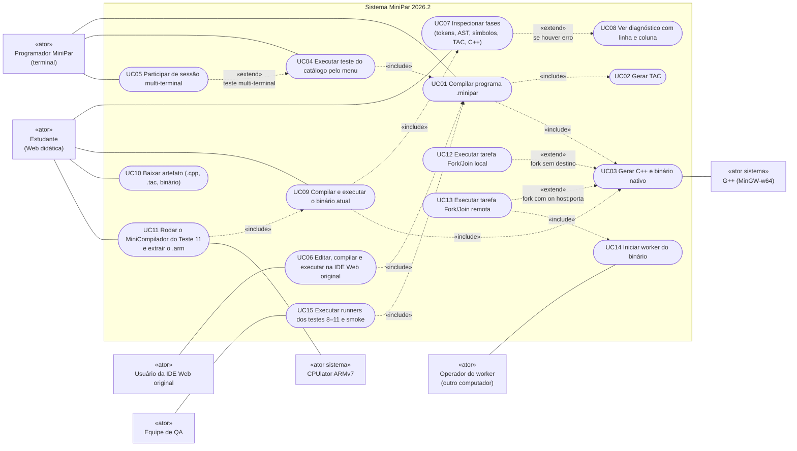

**Nota 2.1.** Mermaid não tem o tipo "diagrama de casos de uso"; o desenho usa um `flowchart`
com a mesma semântica: atores fora da fronteira do sistema, casos de uso como elipses dentro
dela, associações em linha cheia e `«include»`/`«extend»` em linha tracejada, apontando do caso
base para o incluído (include) e do caso que estende para o base (extend), como na UML.
`UC12`/`UC13` estendem `UC03` porque o comportamento de tarefa só existe no binário gerado
quando o programa usa `fork`/`join`. O CPUlator (UC11) é usado **fora** do sistema: a Web
didática extrai o `.arm` da saída do binário; a execução no simulador é manual (C-T11-v1 §3.7).

### 2.2 Descrição dos casos de uso

| ID | Ator | Ponto de entrada real | Resultado |
|---|---|---|---|
| UC01 | Programador | `python main.py <arquivo.minipar> [saida]` → `main.compile_file` | `output/<saida>.tac`, `.cpp` e `.exe`, ou erro da fase |
| UC02 | (incluído) | `TACGenerator.generate` / `generate_text` | Código de três endereços |
| UC03 | (incluído) | `CppCodeGenerator.generate` / `generate_text` + `compile_cpp` | `.cpp` e binário pelo `g++ -std=c++20 -O3` |
| UC04 | Programador | `python main.py` → opção 1 → `menu.exibir_menu` (`rodar_teste`, `rodar_todos`, `escolher_teste`) | Compilação e execução de `tests/*.minipar` |
| UC05 | Programador (2º terminal) | `test_orchestrator.check_active_session_for_new_terminal`, `join_session`, `run_joiner_progress_monitor` | Terminal entra como participante de uma sessão ativa |
| UC06 | Usuário IDE | `python main.py` → opção 2 → `app.py` (porta 5000), `POST /api/compile` | Saída, `.cpp` e `.tac` mostrados na IDE |
| UC07 | Estudante | `POST /api/v1/analyze` (`web_didatica/server.py`) → `service.analyze` | Envelope `minipar.compile.v1` com as fases `lexer`…`cpp` |
| UC08 | (extensão) | `diagnostics[]` do envelope; `erros.js` `criarCartaoErro` | Cartão com código, fase, linha e coluna |
| UC09 | Estudante | `POST /api/v1/compile` → `service.compile_program`; `POST /api/v1/execute` → `service.execute` | Binário da própria requisição executado com stdin e limite de tempo |
| UC10 | Estudante | `GET /api/v1/artifacts/<id>/<tipo>` → `service.get_artifact` | Download do `.cpp`, `.tac` ou binário |
| UC11 | Estudante | `GET /exemplos/t11.json`, depois UC09; `arm.js` `armDaExecucao` | Seção ARM extraída da saída; cópia para o CPUlator |
| UC12 | (extensão) | `fork f(args)` → `minipar_rt::start(id, args)` | Tarefa em thread do `Executor` |
| UC13 | (extensão) | `fork f(args) on "host:porta"` → `minipar_rt::start(id, args, Destination)` | Tarefa executada no worker remoto pelo protocolo C-FJ-v1 §2.6 |
| UC14 | Operador | `<binario> --minipar-worker <porta> [--bind <ip>]` → `worker_main_if_requested` | Processo worker aceitando `HELLO`/`TASK` |
| UC15 | QA | `tests/2026_2/test08/run_t08.py`, `test09/run_t09.py`, `test10/run_t10.py`, `test11/verificar_t11.py`, `scripts/smoke_int01.py` | Relatórios e oráculos dos testes |

---

## 3. Diagrama de componentes

### 3.1 Arquitetura em camadas

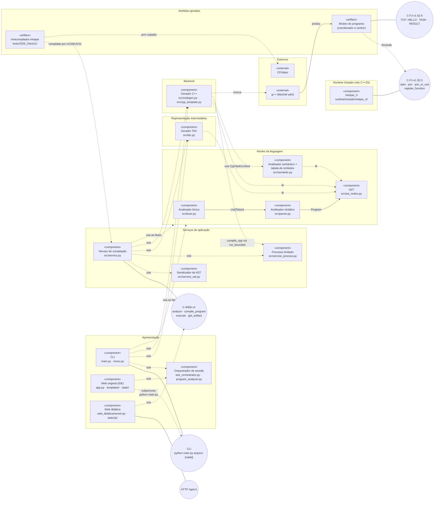

**Nota 3.1.** Mermaid não tem o tipo "diagrama de componentes". Os componentes são caixas
`«component»`; as interfaces fornecidas são círculos ligados ao componente por linha cheia
(notação "pirulito"); o uso de interface ou de outro componente é seta tracejada (dependência).
A seta "usa as fases" aponta para o pacote **Núcleo da linguagem** inteiro: a CLI e o serviço
chamam `Lexer`, `Parser` e `SemanticAnalyzer` diretamente (ver 4.7 e 4.8.1).
As interfaces nomeadas são os contratos de `docs/02_CONTRATOS_TECNICOS.md`.

### 3.2 Componentes, arquivos e interfaces

| Componente | Arquivos | Eixo dono | Interface fornecida | Requer |
|---|---|---|---|---|
| CLI | `main.py`, `menu.py` | A | `python main.py <arquivo> [saida]`; `compile_file(source_path, output_name) -> bool` | Núcleo, TAC, C++, Orquestrador |
| Orquestrador de sessão | `test_orchestrator.py`, `program_analyzer.py` | A | `create_session`, `join_session`, `prepare_test_execution`, `finalize_test_execution`; `analyze_program`, `get_program_spec` | Arquivo `output/.test_session.json` |
| Web original | `app.py`, `templates/index.html`, `static/js/script.js` | A | Rotas `/`, `/api/tests`, `/api/get_test`, `/api/test_spec`, `/api/session[/join\|/create\|/ready\|/clear]`, `/api/compile` | CLI por subprocesso, Orquestrador |
| Web didática | `web_didatica/server.py`, `web_didatica/static/` | B | `GET /`, `/fixtures/<nome>`, `/exemplos/t11.json`; `POST /api/v1/analyze`, `/api/v1/compile`, `/api/v1/execute`; `GET /api/v1/artifacts/<id>/<tipo>` (C-WEB-v1 §1.8) | Serviço de compilação |
| Serviço de compilação | `src/service.py` | A | `analyze`, `compile_program`, `get_artifact`, `execute` (C-WEB-v1 §1.2) | Núcleo, TAC, C++, `service_ast`, `service_process` |
| Serializador de AST | `src/service_ast.py` | A | `serialize_ast(program) -> (ast, stats)` | AST |
| Processo limitado | `src/service_process.py` | A | `run_bounded(command, *, cwd, stdin, timeout, limit, env)` | SO (Job Object no Windows) |
| Analisador léxico | `src/lexer.py` | A | `Lexer(source).tokenize() -> List[Token]`, `diagnostics` | — |
| Analisador sintático | `src/parser.py` | A | `Parser(tokens, exit_on_error=...).parse() -> Program`; `ParseError` | Léxico, AST |
| AST | `src/ast_nodes.py` | A | 37 classes de nó; `iter_child_nodes`, `find_fork_join` | — |
| Semântico + tabela de símbolos | `src/semantic.py` | A | `SemanticAnalyzer.analyze(program) -> bool`, `scopes`, `symbols`, `diagnostics`; `CppTaskContext` | AST |
| Gerador TAC | `src/tac.py` | A | `TACGenerator.generate_text(program) -> str`, `generate(program, output_name) -> str` | AST |
| Gerador C++ | `src/codegen.py`, `src/cpp_template.py` | A | `CppCodeGenerator.generate_text(...) -> str`, `generate(...) -> bool`, `compile_cpp(cpp, exe) -> (payload, code)` | AST, Semântico, `run_bounded`, g++, runtime |
| Runtime `minipar_rt` | `runtime/include/minipar_rt/*.hpp` | C | API C-FJ-v1 §2.3 e protocolo §2.6 | Threads e sockets do SO |
| MiniCompilador T11 | `tests/2026_2/test11/minicompilador.minipar` | B | Programa MiniPar: lê a expressão, imprime tokens, AST, TAC, ARM, símbolos e resultado | Primitivas C-T11-v1 §3.3 |

---

## 4. Diagramas de classes por componente

### 4.1 Analisador léxico

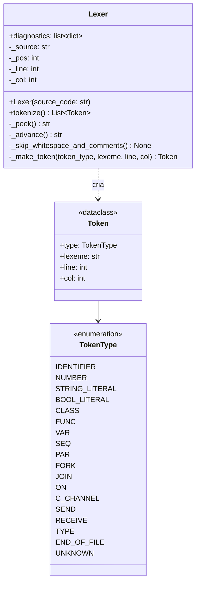

`TokenType` tem 57 valores; o diagrama mostra os literais e as palavras-chave da extensão
2026.2 (`FORK`, `JOIN`, `ON`, `TYPE`) e omite operadores e pontuação (`PLUS` … `COMMA`). A
lista completa e a gramática estão em [`12_BNF_MINIPAR_2026_2.md`](12_BNF_MINIPAR_2026_2.md).
Erros léxicos não interrompem a varredura: entram em `diagnostics` (`LEX_*`) e o token vira
`UNKNOWN`.

### 4.2 Árvore sintática abstrata (AST)

```mermaid
classDiagram
    direction LR
    %% @fonte ASTNode src/ast_nodes.py
    %% @fonte Program src/ast_nodes.py
    %% @fonte NumberExpr src/ast_nodes.py
    %% @fonte StringExpr src/ast_nodes.py
    %% @fonte BoolExpr src/ast_nodes.py
    %% @fonte IdentifierExpr src/ast_nodes.py
    %% @fonte BinaryExpr src/ast_nodes.py
    %% @fonte UnaryExpr src/ast_nodes.py
    %% @fonte FuncCallExpr src/ast_nodes.py
    %% @fonte MethodCall src/ast_nodes.py
    %% @fonte PropertyAccess src/ast_nodes.py
    %% @fonte NewExpr src/ast_nodes.py
    %% @fonte ThisExpr src/ast_nodes.py
    %% @fonte ListLiteral src/ast_nodes.py
    %% @fonte MatrixCreateExpr src/ast_nodes.py
    %% @fonte IndexExpr src/ast_nodes.py
    %% @fonte InputExpr src/ast_nodes.py
    %% @fonte CChannelExpr src/ast_nodes.py
    %% @fonte ReceiveExpr src/ast_nodes.py
    %% @fonte ForkExpr src/ast_nodes.py
    %% @fonte JoinExpr src/ast_nodes.py
    class ASTNode {
        +line: int
    }
    class Program {
        +statements: List~ASTNode~
    }
    class NumberExpr { +value: str }
    class StringExpr { +value: str }
    class BoolExpr { +value: bool }
    class IdentifierExpr { +name: str }
    class BinaryExpr {
        +op: str
        +left: ASTNode
        +right: ASTNode
    }
    class UnaryExpr {
        +op: str
        +operand: ASTNode
    }
    class FuncCallExpr {
        +name: str
        +arguments: List~ASTNode~
    }
    class MethodCall {
        +object: ASTNode
        +method_name: str
        +arguments: List~ASTNode~
    }
    class PropertyAccess {
        +object: ASTNode
        +property_name: str
    }
    class NewExpr {
        +class_name: str
        +arguments: List~ASTNode~
    }
    class ThisExpr
    class ListLiteral { +elements: List~ASTNode~ }
    class MatrixCreateExpr {
        +rows: ASTNode
        +cols: ASTNode
        +init_value: ASTNode
    }
    class IndexExpr {
        +object: ASTNode
        +index: ASTNode
    }
    class InputExpr { +prompt: Optional~ASTNode~ }
    class CChannelExpr {
        +ip: ASTNode
        +port: ASTNode
    }
    class ReceiveExpr { +channel: ASTNode }
    class ForkExpr {
        +function_name: str
        +arguments: List~ASTNode~
        +destination: Optional~ASTNode~
        +column: int
    }
    class JoinExpr {
        +handle: ASTNode
        +timeout: Optional~ASTNode~
        +column: int
    }
    ASTNode <|-- Program
    ASTNode <|-- NumberExpr
    ASTNode <|-- StringExpr
    ASTNode <|-- BoolExpr
    ASTNode <|-- IdentifierExpr
    ASTNode <|-- BinaryExpr
    ASTNode <|-- UnaryExpr
    ASTNode <|-- FuncCallExpr
    ASTNode <|-- MethodCall
    ASTNode <|-- PropertyAccess
    ASTNode <|-- NewExpr
    ASTNode <|-- ThisExpr
    ASTNode <|-- ListLiteral
    ASTNode <|-- MatrixCreateExpr
    ASTNode <|-- IndexExpr
    ASTNode <|-- InputExpr
    ASTNode <|-- CChannelExpr
    ASTNode <|-- ReceiveExpr
    ASTNode <|-- ForkExpr
    ASTNode <|-- JoinExpr
    Program *-- ASTNode : statements
```

*Figura 4.2a — raiz e nós de expressão.*

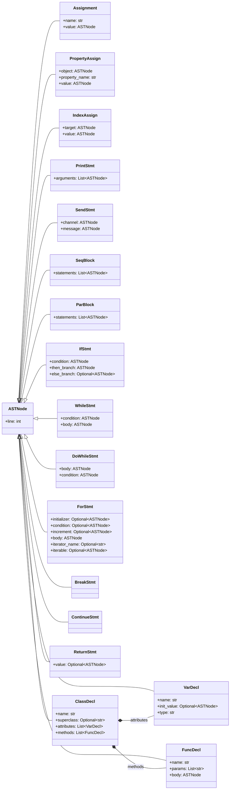

*Figura 4.2b — declarações e comandos.*

Todas as classes de nó são `@dataclass` com `line: int = 1`. `ForStmt` representa as duas
formas de `for`: com `initializer`/`condition`/`increment` ou com `iterator_name in iterable`.
`fork` e `join` são **expressões** (`ForkExpr`, `JoinExpr`); `par { ... }` é o comando
`ParBlock`. O módulo também oferece as funções `iter_child_nodes(node)` e
`find_fork_join(node)`, usadas pelos geradores.

### 4.3 Analisador sintático

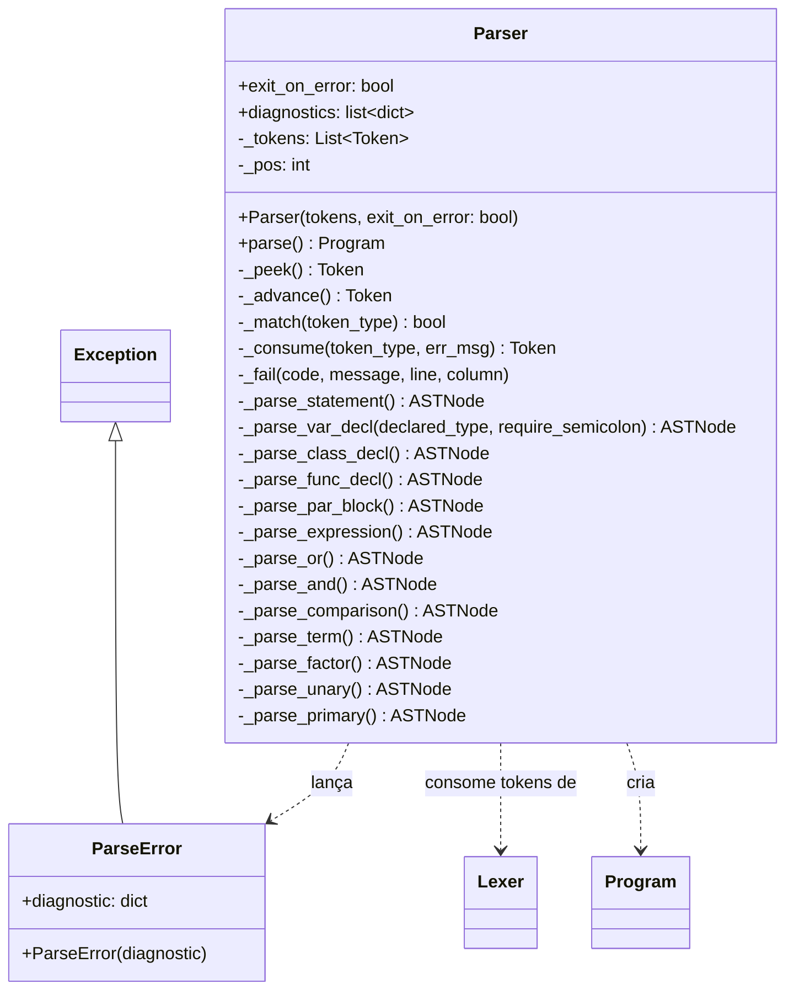

Descida recursiva com um método por nível de precedência (`_parse_or` → `_parse_primary`).
Em erro, `_fail` monta o diagnóstico `SYN_*`; com `exit_on_error=True` (CLI) imprime e encerra
o processo, com `exit_on_error=False` (serviço) lança `ParseError`. Pseudocódigo em
[`13_PSEUDOCODIGOS_NUCLEO.md`](13_PSEUDOCODIGOS_NUCLEO.md).

### 4.4 Analisador semântico e tabela de símbolos

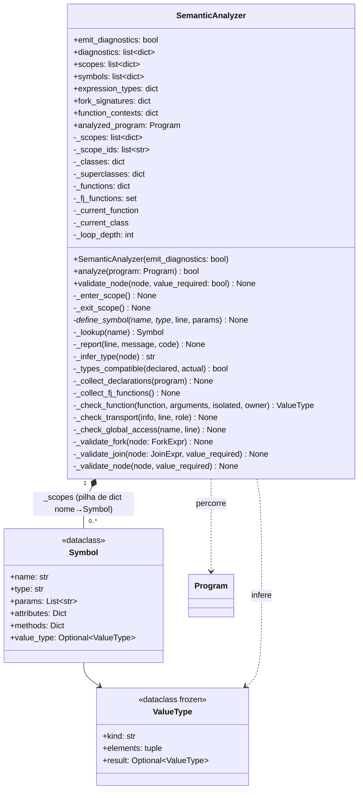

**Tabela de símbolos.** Não há classe `SymbolTable` no código: a tabela é a pilha
`_scopes` (uma lista de dicionários `nome → Symbol`) mantida por `_enter_scope`,
`_exit_scope`, `_define_symbol` e `_lookup` (busca do escopo mais interno para o global).
Para as interfaces, o analisador **publica** duas listas de registros planos:

| Lista | Campos de cada registro | Preenchida em |
|---|---|---|
| `scopes` | `id` (`s0`, `s1`, …), `kind` (`global`, `class`, `function`, `method`, `seq`, `par`, `for`), `name`, `parent`, `line` | `_enter_scope` |
| `symbols` | `name`, `kind` (`class`, `attribute`, `method`, `function`, `parameter`, `variable`, `iterator`), `type`, `scope`, `line`, `params` | `_define_symbol` |

Essas listas são as que o serviço devolve na fase `semantic` do envelope C-WEB-v1 e que a
Web didática desenha como árvore de escopos. As regras FJ-SEM-01…08 ficam em
`_collect_fj_functions`, `_check_function`, `_validate_fork` e `_validate_join`.

### 4.5 Gerador TAC

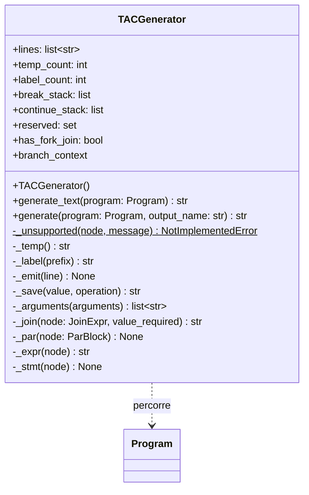

`generate_text` devolve o texto (usado pelo serviço); `generate` grava
`output/<nome>.tac` e devolve o caminho (usado pela CLI). Construções sem tradução lançam
`NotImplementedError` com prefixo `Linha N:`, que o serviço converte em
`TAC_UNSUPPORTED_FEATURE`. `fork`, `join` e `par` têm tradução própria (`_join`, `_par`);
detalhes em `docs/auditorias/CORE-06_TAC_FORK_JOIN.md`.

### 4.6 Gerador C++ (backend)

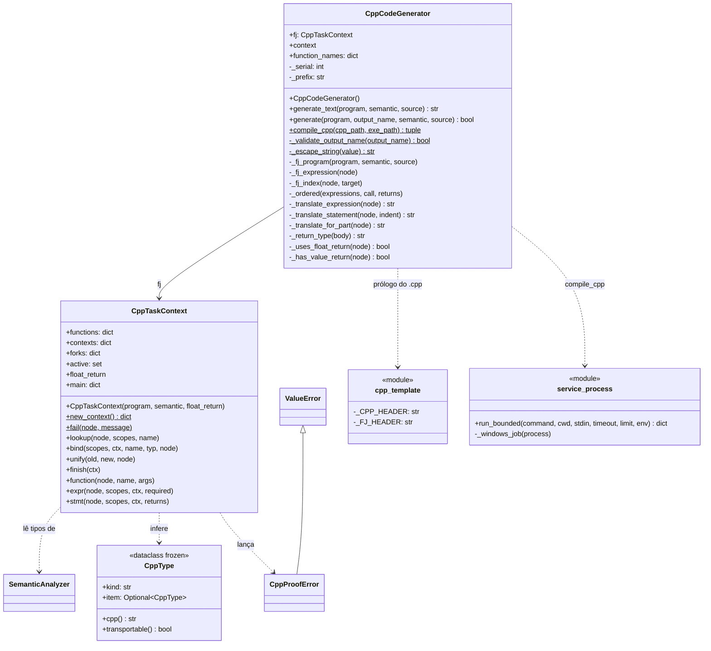

Duas rotas de geração convivem em `generate_text`:

- **Programa sem `fork`/`join`:** tradução direta da AST (`_translate_statement`,
  `_translate_expression`) com o prólogo `_CPP_HEADER` (funções nativas, `MiniParChannel`
  para `c_channel`/`send`/`receive`).
- **Programa com `fork`/`join` (CORE-07):** `CppTaskContext` prova os tipos C++ de cada função
  de tarefa (`CppType`; recusa com `CppProofError`) e `_fj_program` gera as funções tipadas, os
  invólucros `__fj_wrap_<f>(const TaskArgs&)`, o `register_function` de cada uma, o
  `set_build_id(sha256 do fonte)` e o `worker_main_if_requested(argc, argv)` no `main`,
  incluindo o prólogo `_FJ_HEADER` (`#include "minipar_rt/minipar_rt.hpp"`).

`compile_cpp` chama `g++ -std=c++20 -O3 <cpp> -o <exe> -pthread -I runtime/include`
(`-lws2_32` no Windows) por `run_bounded`, com limite de 120 s, e devolve
`(payload, code)` com `code` em `GPP_TIMEOUT`, `GPP_FAILED`, `GPP_NO_BINARY`, `GPP_NOT_FOUND`
ou `None`.

### 4.7 Serviço de compilação (C-WEB-v1)

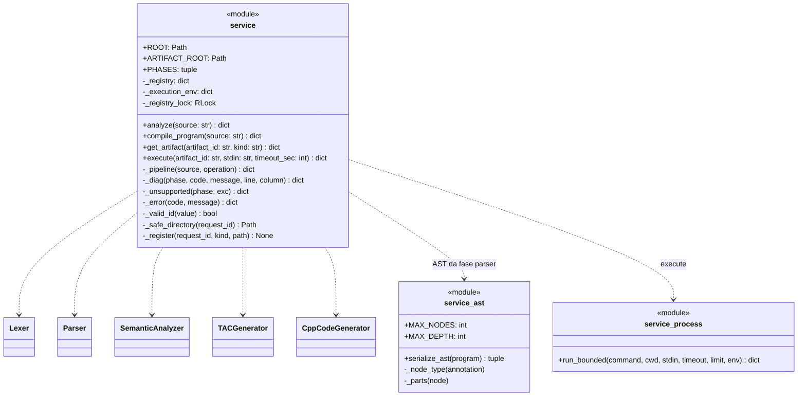

O serviço é um módulo de funções, não uma classe. `_pipeline` roda as fases na ordem de
`PHASES` (`lexer`, `parser`, `semantic`, `tac`, `cpp`, `gpp`), para na primeira com erro e
marca as seguintes como `skipped`/`previous_phase_failed`; `analyze` não executa `gpp`
(`not_requested`). Cada compilação usa o diretório `output/web/<request_id>/` e registra os
artefatos em `_registry` (vivo durante todo o processo, sem limpeza). Envelopes:
`minipar.compile.v1` (`analyze`/`compile_program`) e `minipar.execute.v1` (`execute`).

### 4.8 Apresentação

#### 4.8.1 CLI e Web original

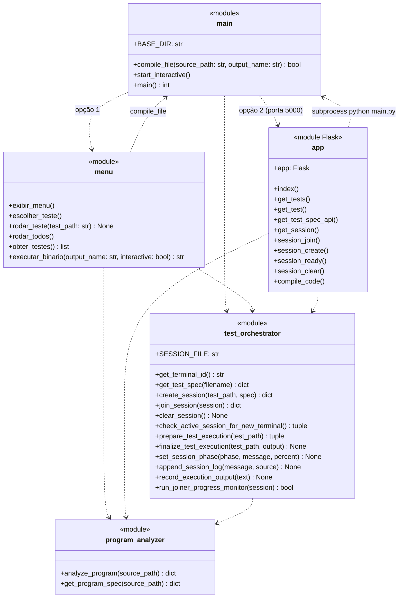

| Rota (`app.py`) | Método | Função |
|---|---|---|
| `/` | GET | `index` |
| `/api/tests` | GET | `get_tests` |
| `/api/get_test` | POST | `get_test` |
| `/api/test_spec` | POST | `get_test_spec_api` |
| `/api/session` | GET | `get_session` |
| `/api/session/join`, `/create`, `/ready`, `/clear` | POST | `session_join`, `session_create`, `session_ready`, `session_clear` |
| `/api/compile` | POST | `compile_code` (grava em `temp_code/`, roda `python main.py`, executa `output/<nome>.exe`) |

#### 4.8.2 Web didática

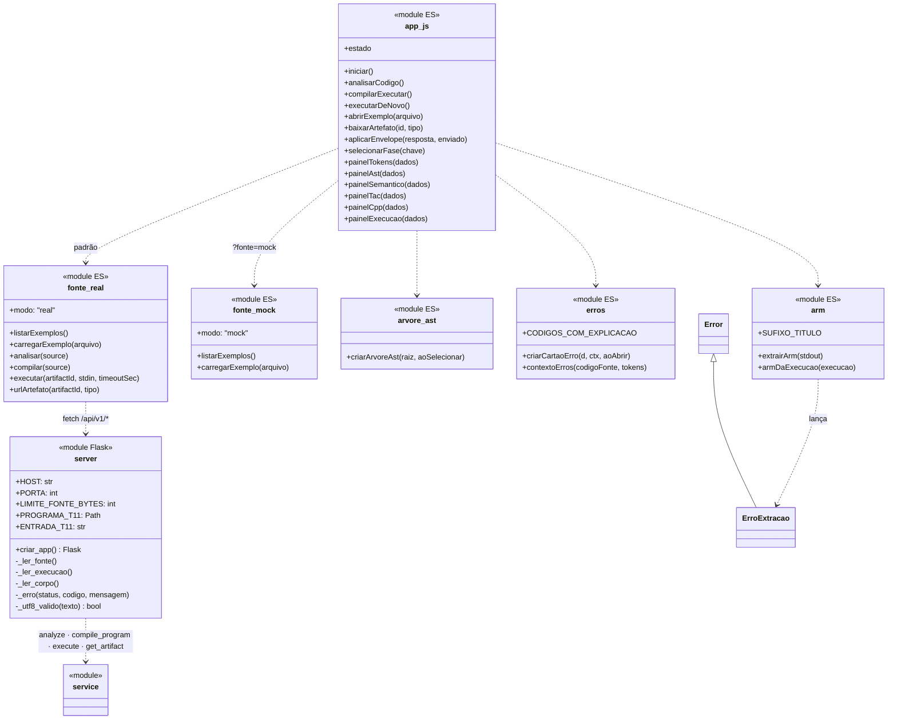

`app.js` escolhe a fonte de dados uma vez: `fonte_real` (HTTP para o servidor) ou
`fonte_mock` (fixtures JSON de `web_didatica/fixtures/`, só leitura, sem compilar). As duas
expõem `modo`, `listarExemplos` e `carregarExemplo`; apenas `fonte_real` expõe
`analisar`/`compilar`/`executar`/`urlArtefato`. Não existe uma interface JS formal comum: o
contrato é por convenção de nomes. As rotas do servidor estão na tabela da seção 3.2.

### 4.9 Runtime `minipar_rt` (Fork/Join local e distribuído)

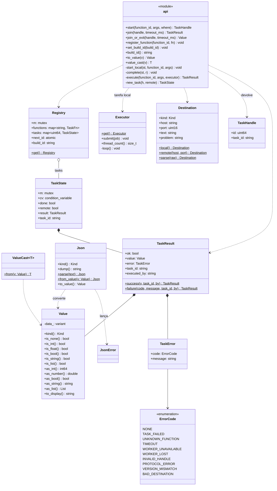

*Figura 4.9a — núcleo do runtime (`value.hpp`, `json.hpp`, `core.hpp`, `api.hpp`).* As
funções `register_function`, `set_build_id`, `build_id` ficam em `core.hpp`; `to_value` e
`value_cast` em `value.hpp`; `start`, `join` e `join_or_exit` em `api.hpp`. Elas aparecem
juntas no módulo `api` porque formam a API C-FJ-v1 §2.3 que o código gerado chama. Os
membros `-` são do namespace `minipar_rt::detail`.

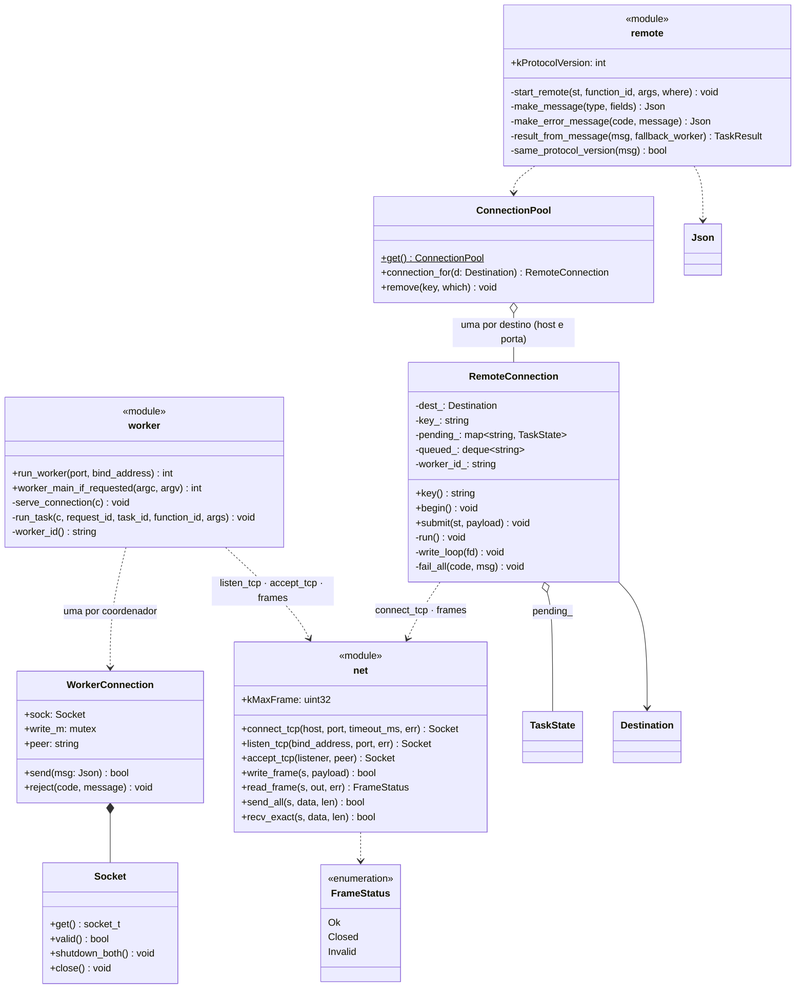

*Figura 4.9b — execução remota (`remote.hpp`, `worker.hpp`, `net.hpp`).* O mesmo binário é
coordenador ou worker: `worker_main_if_requested` só assume o processo quando recebe
`--minipar-worker <porta>`. Detalhes do protocolo e dos códigos de erro em C-FJ-v1 §2.5–2.6.

### 4.10 MiniCompilador do Teste 11 (classe escrita em MiniPar)

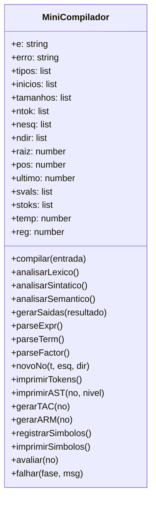

Os tokens e os nós da AST ficam em **listas numéricas paralelas** (`tipos`/`inicios`/`tamanhos`
e `ntok`/`nesq`/`ndir`) porque listas de strings estão fora do recorte (C-T11-v1 §3.4); o texto
de cada token é recuperado da entrada com `substr`. MiniPar não tem modificadores de acesso:
todos os membros são públicos. O programa principal cria `new MiniCompilador()` e chama
`compilar(input(...))`.

---

## 5. Diagramas de sequência

### 5.1 Compilar e executar pela Web didática (UC09)

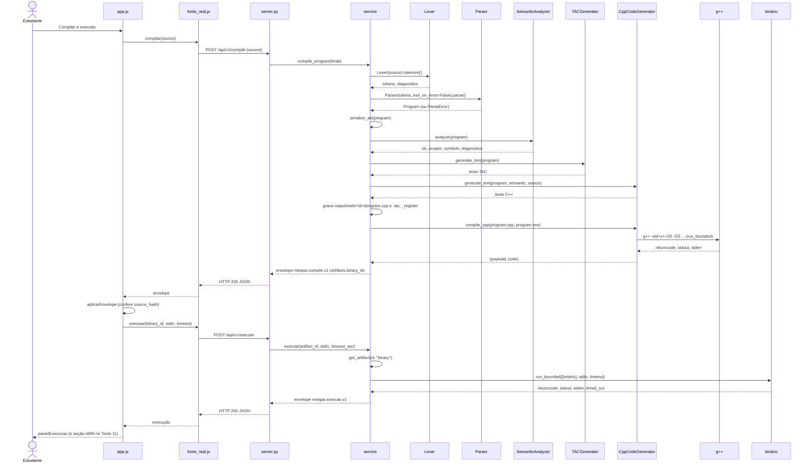

Em qualquer fase com erro, o serviço para, devolve `ok: false` com o diagnóstico e as fases
seguintes `skipped`; o servidor responde HTTP 200 mesmo assim (C-WEB-v1 §1.8). A CLI
(`main.compile_file`) segue a mesma ordem de fases, mas grava em `output/<nome>.*`, usa
`Parser` com `exit_on_error=True` e `TACGenerator.generate`/`CppCodeGenerator.generate`.

### 5.2 Fork/Join local e remoto no binário gerado (UC12, UC13)

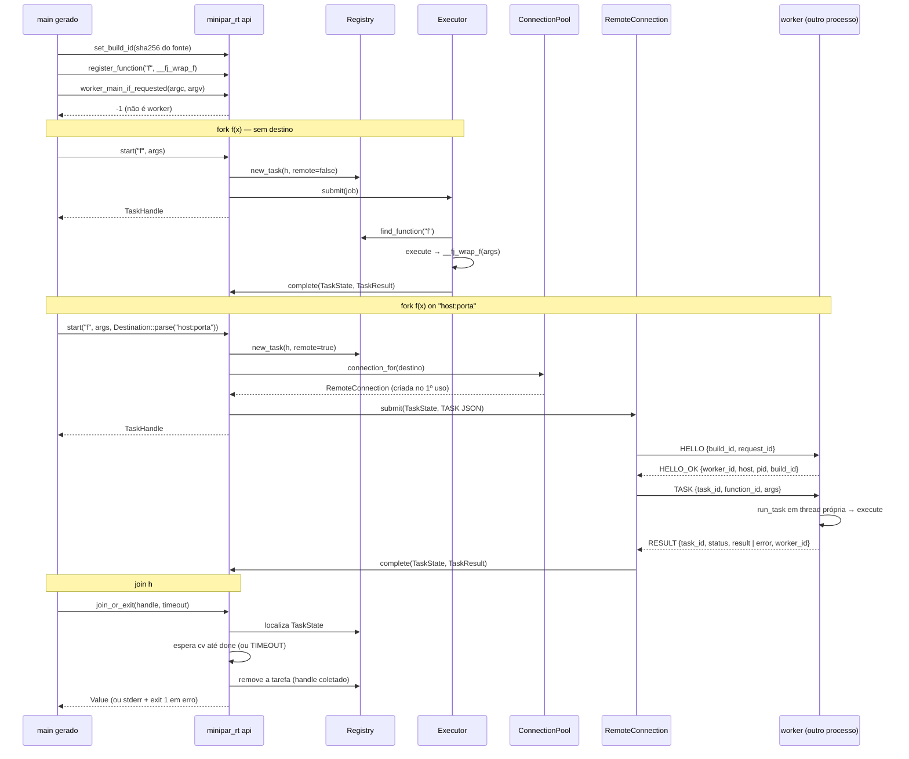

A conexão é uma por destino `host:porta` e é reutilizada; o `HELLO` acontece uma vez por
conexão (no diagrama, antes do primeiro `TASK`). Se `build_id` ou `protocol_version` não
conferem, todas as tarefas pendentes daquela conexão terminam com `VERSION_MISMATCH`. Perda
de conexão termina as pendentes com `WORKER_LOST`; worker inacessível, com
`WORKER_UNAVAILABLE`.

---

## 6. Correspondência com os componentes exigidos

Componentes pedidos em `00_DOCUMENTO_MESTRE_INICIAL.md` §11.1 e onde estão modelados:

| Componente exigido | Componente / classe real | Diagrama |
|---|---|---|
| Analisador léxico | `Lexer`, `Token`, `TokenType` | 3.1, 4.1 |
| Analisador sintático | `Parser`, `ParseError`; AST em `ast_nodes` | 3.1, 4.2, 4.3 |
| Analisador semântico | `SemanticAnalyzer`, `ValueType` | 3.1, 4.4 |
| Tabela de símbolos | `Symbol` + pilha `_scopes`; listas publicadas `scopes`/`symbols` | 4.4 |
| Gerador TAC | `TACGenerator` | 3.1, 4.5 |
| Gerador C++ | `CppCodeGenerator`, `CppTaskContext`, `CppType`, `cpp_template` | 3.1, 4.6 |
| Controle/orquestração do compilador | `main.compile_file` (CLI) e `service._pipeline` (serviço) | 3.1, 4.7, 4.8.1, 5.1 |
| Execução | `CppCodeGenerator.compile_cpp`, `service.execute`, `run_bounded`, `Executor` | 4.6, 4.7, 4.9 |
| Comunicação | `MiniParChannel` (C++ do `c_channel`), `RemoteConnection`, `ConnectionPool`, `WorkerConnection`, `net` | 4.6, 4.9, 5.2 |
| Interfaces | CLI, Web original, Web didática; contratos C-WEB-v1, C-FJ-v1, C-T11-v1 | 2, 3, 4.8 |

Os diagramas recomendados de §11.4 também estão cobertos: fluxo de compilação (5.1),
sequência de Fork/Join e comunicação distribuída (5.2) e fluxo da interface didática (5.1).

---

## 7. Observações sobre a implementação real

Pontos em que o modelo segue o código e não uma arquitetura idealizada. Nenhum deles é
defeito apontado por este card; ficam registrados para quem revisar ou escrever o relatório.

1. **Sem interfaces abstratas entre as fases.** As fases são classes concretas chamadas em
   sequência por `main.compile_file` e por `service._pipeline`. O "contrato" entre elas é o
   tipo dos dados (`List[Token]`, `Program`, `SemanticAnalyzer` já analisado). Isso segue a
   decisão de `00_DOCUMENTO_MESTRE_INICIAL.md` §11.3 de não criar camadas artificiais.
2. **Dois orquestradores.** A CLI e o serviço repetem a sequência de fases com diferenças
   reais: a CLI grava em `output/`, usa `exit_on_error=True` e imprime; o serviço captura
   diagnósticos, isola cada requisição em `output/web/<id>/` e devolve envelopes.
3. **A Web original não usa o serviço.** `app.compile_code` chama `python main.py` por
   subprocesso e lê os arquivos de `output/`. Só a Web didática consome C-WEB-v1.
4. **A tabela de símbolos não é uma classe.** Ver 4.4.
5. **`CppTaskContext` mora em `semantic.py`** mas é usada só pelo gerador C++
   (`CppCodeGenerator.fj`). O diagrama de componentes mostra essa dependência como
   "Gerador C++ usa CppTaskContext".
6. **Runtime header-only.** `minipar_rt` não é uma biblioteca compilada à parte: entra no
   binário por `#include` e `-I runtime/include` em `compile_cpp`.
7. **Canais legados x Fork/Join.** `c_channel`/`send`/`receive` usam `MiniParChannel`
   (`cpp_template.py`, sockets próprios) e não o protocolo do `minipar_rt`.

---

## 8. Verificação dos diagramas

Script: [`auditorias/DOC-02_sondas_uml.py`](auditorias/DOC-02_sondas_uml.py). Ele lê os blocos
`classDiagram` deste arquivo e confere, para cada classe com `%% @fonte`:

- a classe (ou módulo) existe no arquivo indicado;
- cada atributo e método listado existe naquela classe ou módulo (Python por AST; C++, JS e
  MiniPar por busca de declaração no arquivo);
- cada herança `Pai <|-- Filho` existe no código (Python e JS);
- **cobertura:** toda classe de `src/*.py`, todo `class`/`struct`/`enum class` de nível de
  namespace em `runtime/include/minipar_rt/*.hpp` e todo módulo de
  `web_didatica/static/js/*.js` aparece em algum diagrama.

Resultado e controle negativo estão no handoff
[`auditorias/DOC-02_UML.md`](auditorias/DOC-02_UML.md). Mudanças em `src/`, `runtime/include/`
ou `web_didatica/static/js/` exigem reexecutar as sondas.
