# Seção do relatório — Interface Web didática

> Card `WEB-05` (Eixo B). Texto pronto para o `DOC-04` copiar para o relatório. Fonte da verdade:
> `web_didatica/` (código e `web_didatica/README.md`), contrato C-WEB-v1
> (`docs/02_CONTRATOS_TECNICOS.md` §1) e serviço `src/service.py` do Eixo A (`CORE-08`). As
> figuras são de `docs/evidencias/WEB-05/` e foram geradas e conferidas por
> `web_didatica/tools/capturar_telas.py` (seção 6).

## 1. Objetivo

A Web didática é a terceira interface do MiniPar 2026.2, ao lado do terminal (`main.py`,
`menu.py`) e da Web anterior (`app.py`), que continuam como estavam. Ela mostra **cada fase da
compilação real** de um programa MiniPar: tokens, AST, escopos e símbolos, TAC, C++ e, sob
pedido, a compilação pelo g++ e a execução do binário com entrada (stdin) e tempo limite. Os
erros aparecem como cartões legíveis, com o trecho do código, a coluna marcada e uma explicação
em português. O usuário pode baixar o `.cpp`, o `.tac` e o binário da compilação exibida e, no
Teste 11, o `.arm` gerado pelo MiniCompilador.

Nenhum resultado exibido é gravado ou fixo: tudo vem do compilador e do binário no momento do
pedido. As fixtures do contrato só fornecem o código-fonte dos exemplos. O modo mock
(`?fonte=mock`), usado no desenvolvimento antes do serviço real existir, continua disponível e
é identificado por uma faixa amarela (figura 17).

## 2. Arquitetura

```text
Navegador (static/index.html + js/)
   │  fetch JSON
   ▼
web_didatica/server.py  (Flask, só 127.0.0.1:5001)      ← Eixo B
   │  valida a requisição e chama, sem alterar o resultado:
   ▼
src/service.py  analyze · compile_program · execute · get_artifact   ← Eixo A (CORE-08)
   │
   ├─ Lexer → Parser/AST → Semântico/símbolos → TAC → C++   (compilador hospedeiro)
   ├─ g++ -std=c++20 -O3 … -pthread -lws2_32  →  binário em output/web/<request_id>/
   └─ execução do binário com stdin e tempo limite (processo encerrado no tempo esgotado)
```

| Rota (C-WEB-v1 §1.8) | Uso na tela |
|---|---|
| `POST /api/v1/analyze` | ao abrir um exemplo, no botão **Analisar** ou Ctrl+Enter: fases Lexer até C++, sem g++ |
| `POST /api/v1/compile` | botão **Compilar e executar**: as seis fases, com g++ e artefatos próprios da requisição |
| `POST /api/v1/execute` | logo depois do `compile` com `ok: true`, e no botão **Executar de novo** |
| `GET /api/v1/artifacts/<id>/<kind>` | botões **Baixar .cpp**, **.tac** e **binário** |
| `GET /exemplos/t11.json` | exemplo T11: código de `tests/2026_2/test11/minicompilador.minipar` |

Três regras do contrato que a tela segue e que aparecem nas figuras:

- **Resposta só vale para o código atual (§1.3).** Cada resposta traz o `source_hash` (SHA-256
  do código analisado). Se o usuário editou o código enquanto o servidor trabalhava, a página
  descarta a resposta e avisa; uma compilação descartada nunca é executada.
- **Sucesso é definido pelos campos, não pela ausência de erro (§1.6).** A execução só é
  sucesso com `exit_code` 0 e `timed_out` falso. Tempo esgotado, código diferente de 0 e binário
  inexistente têm caixas próprias (figura 12).
- **Downloads da compilação exibida (§1.7).** Os botões usam os ids da compilação que está na
  tela; uma compilação feita em outra aba tem outro id e não troca o arquivo baixado.

## 3. Como iniciar

Pré-requisitos: Python com a `.venv` do projeto (Flask 3.0.0, `requeriments.txt`) e o g++ C++20
no `PATH` (`docs/10_GUIA_SETUP_REPOSITORIO.md`). Na raiz do repositório:

```bash
.venv\Scripts\python.exe -B web_didatica/server.py
```

Abrir `http://127.0.0.1:5001/` no navegador. O servidor escuta só no próprio computador, sem
modo debug. Para o modo mock, abrir `http://127.0.0.1:5001/static/index.html?fonte=mock`.

## 4. Passo a passo com as telas

A tela tem, à esquerda, o editor com numeração de linhas, os botões, a entrada (stdin), o tempo
limite, a linha de andamento e os diagnósticos; à direita, a trilha de fases Tokens → AST →
Semântico → TAC → C++ → Compilar e executar, cada uma com o status (`●` verde ok, vermelho
erro, `○` não executada) e o painel da fase escolhida. O rodapé mostra a operação, o
`request_id` e o `source_hash` da resposta exibida.

### 4.1 Analisar um programa (FIX-01: `var x = 2 + 3; print(x);`)

1. Escolher o exemplo em **Exemplo**. O código vai para o editor e é analisado na hora pelo
   serviço real. A faixa verde "SERVIÇO REAL" indica a origem dos dados.

   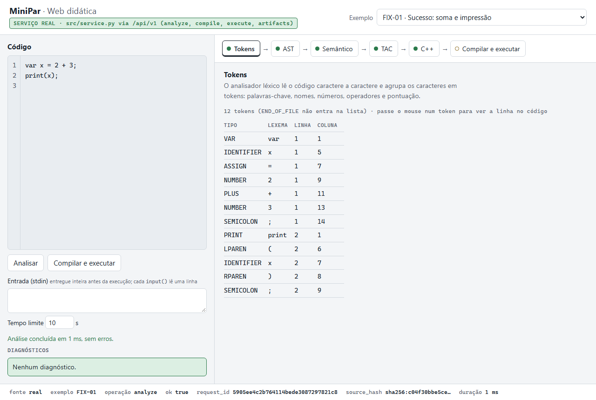

   *Figura 1 — Tokens do FIX-01: tipo, lexema, linha e coluna de cada um dos 12 tokens.
   Passar o mouse num token destaca a linha dele no editor.*

2. **AST.** A árvore abre com três níveis; a seta abre ou fecha cada nó, e um nó fechado mostra
   quantos descendentes esconde (`+2`). Ao clicar num nó, o quadro ao lado mostra tipo, papel no
   pai, linha, nível, filhos, atributos e o caminho até a raiz, e a linha fica destacada no
   editor. A árvore também é navegável pelo teclado.

   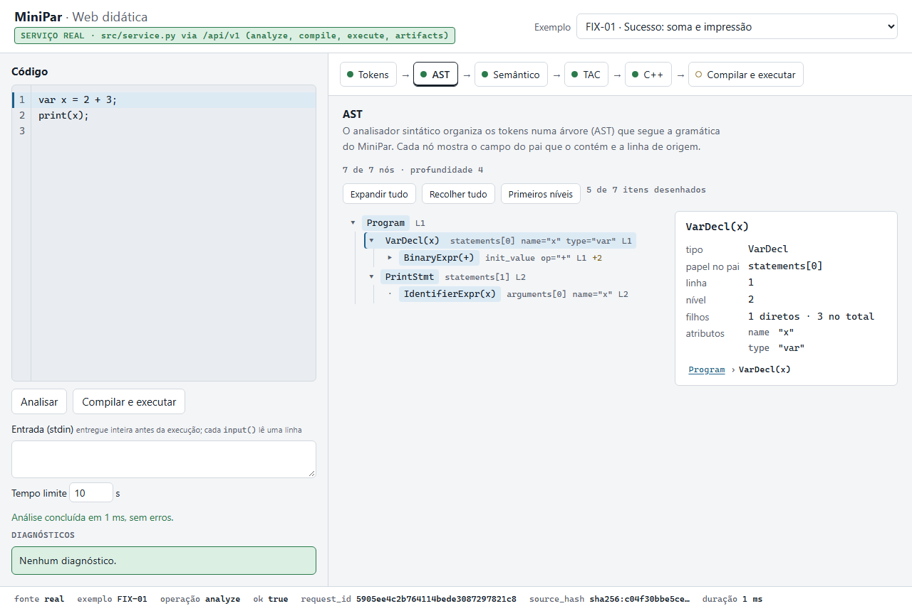

   *Figura 2 — AST do FIX-01 com `VarDecl(x)` selecionado.*

3. **Semântico.** Escopos aninhados com os símbolos de cada um (nome, categoria, tipo, linha,
   parâmetros) e um filtro por nome.

   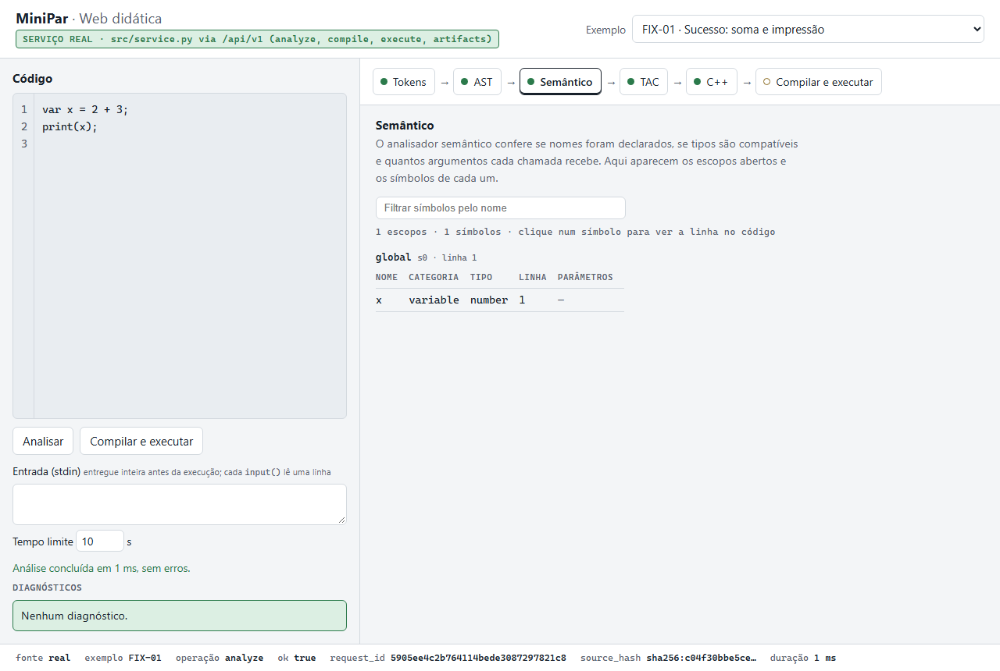

   *Figura 3 — Escopo global com a variável `x` do tipo `number`.*

4. **TAC** e **C++**, com numeração de linhas. O TAC do FIX-01 é `t0 = 2 + 3`, `x = t0`,
   `print x`; o C++ é o que o g++ vai compilar.

   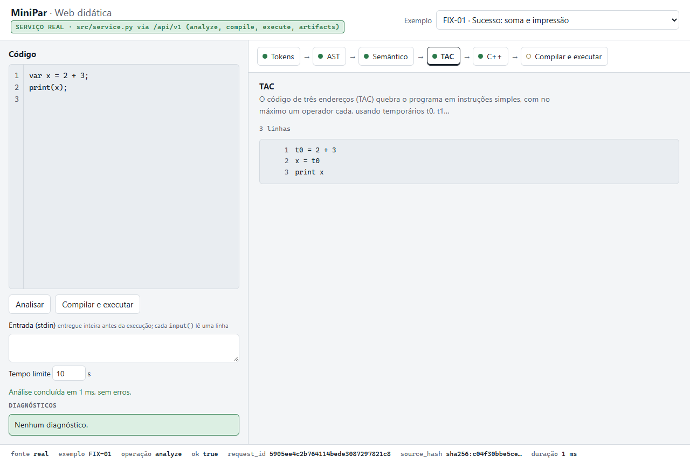

   *Figura 4 — Código de três endereços do FIX-01.*

   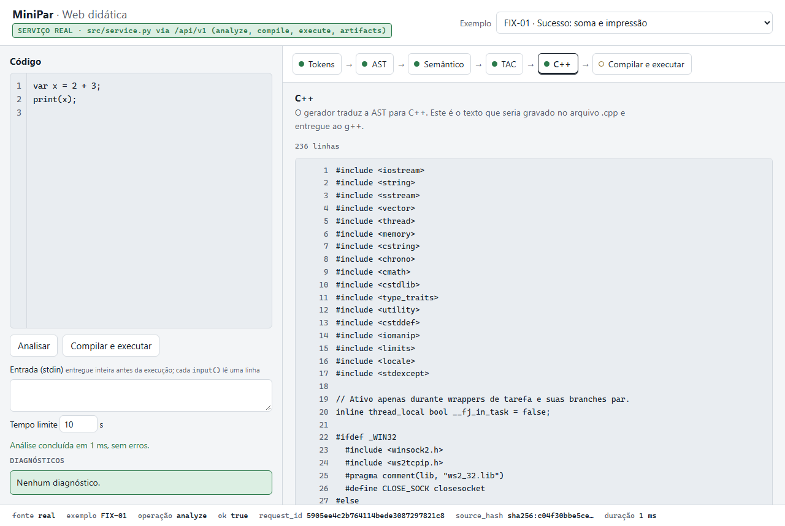

   *Figura 5 — C++ gerado para o FIX-01.*

### 4.2 Compilar, executar e baixar

5. **Compilar e executar** manda o código ao `compile`. Com sucesso, a página executa o binário
   daquela compilação com a entrada e o tempo limite escolhidos. O painel mostra o comando do
   g++, o código de retorno, a duração, os ids da compilação e do binário, e depois a execução:
   entrada usada, tempo limite, código de saída, tempo esgotado e duração.

   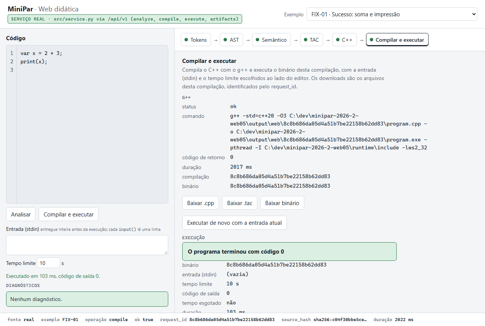

   *Figura 6 — FIX-01 compilado pelo g++ (código de retorno 0) e executado (código de saída 0).*

6. Mais abaixo ficam a saída do programa (stdout e, se houver, stderr) e os downloads.
   **Executar de novo com a entrada atual** roda o mesmo binário sem recompilar.

   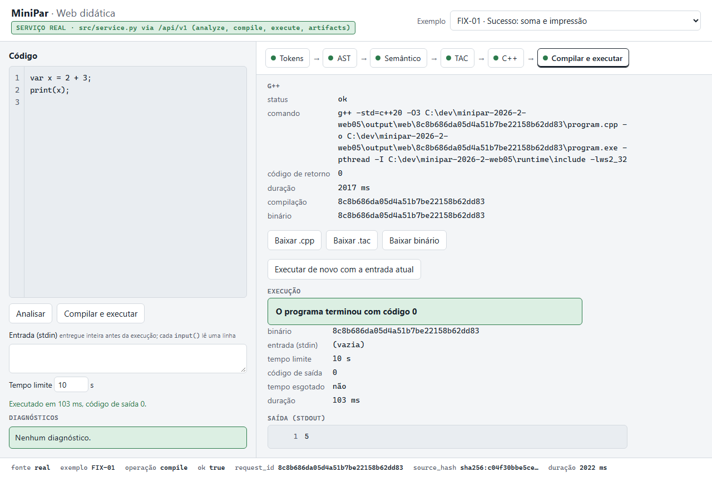

   *Figura 7 — stdout `5` e os botões Baixar .cpp, .tac e binário da compilação exibida.*

### 4.3 Erros de compilação

7. Cada erro é um cartão com fase, linha e coluna, o trecho do código com `^` na coluna, uma
   explicação em português e a mensagem original do compilador com o código do catálogo
   (C-WEB-v1 §1.5). Clicar no cabeçalho do cartão abre a fase e destaca a linha. As fases
   seguintes ficam marcadas como não executadas, com o motivo.

   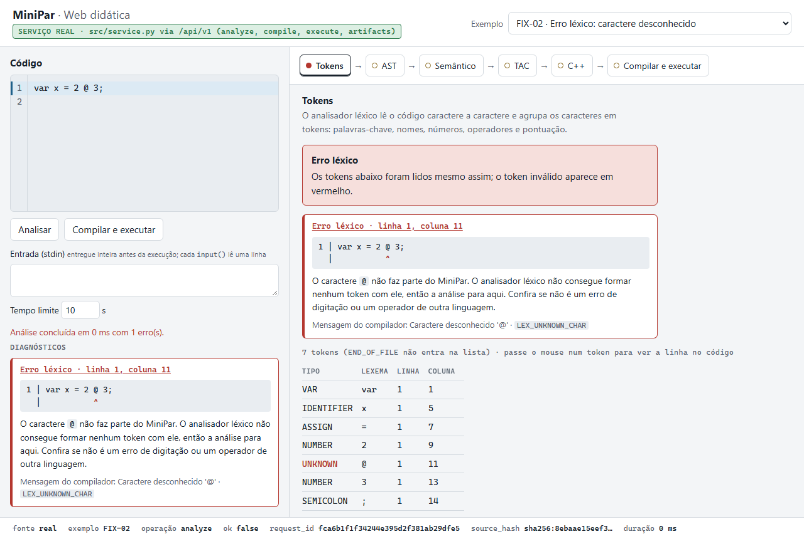

   *Figura 8 — Erro léxico (FIX-02, `var x = 2 @ 3;`): `LEX_UNKNOWN_CHAR` na linha 1, coluna 11.*

   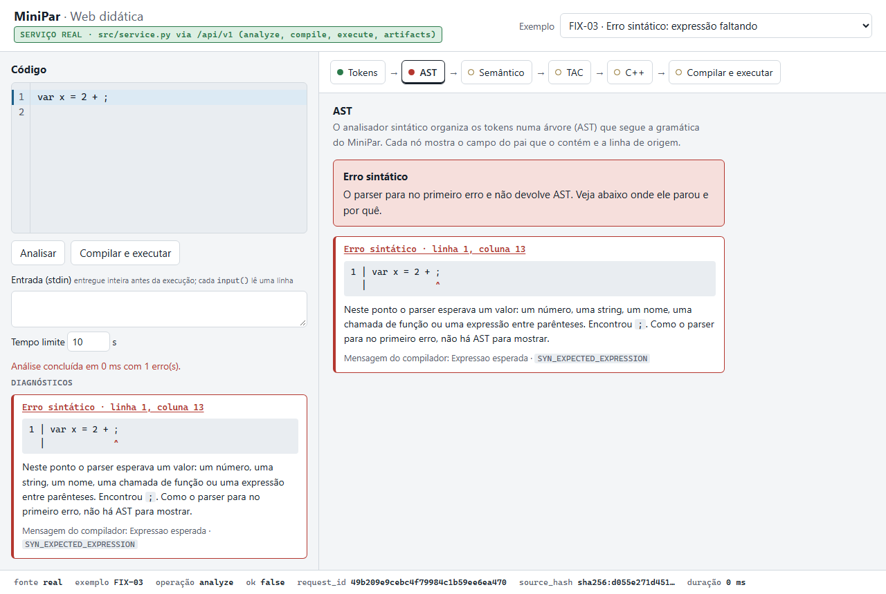

   *Figura 9 — Erro sintático (FIX-03, `var x = 2 + ;`): `SYN_EXPECTED_EXPRESSION`; o parser
   para no primeiro erro e não há AST.*

   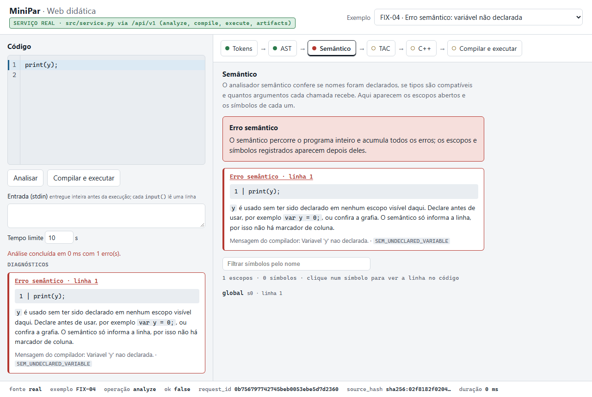

   *Figura 10 — Erro semântico (FIX-04, `print(y);`): `SEM_UNDECLARED_VARIABLE`.*

### 4.4 Programas maiores

8. Programas grandes não travam a página: tokens, símbolos e linhas de código são desenhados em
   blocos de 500, e os filhos de um nó da AST só são desenhados quando ele é aberto (200 por
   vez). Acima de 5000 nós o serviço trunca a AST e a tela mostra o marcador `Truncated`
   (exemplo PROG-02).

   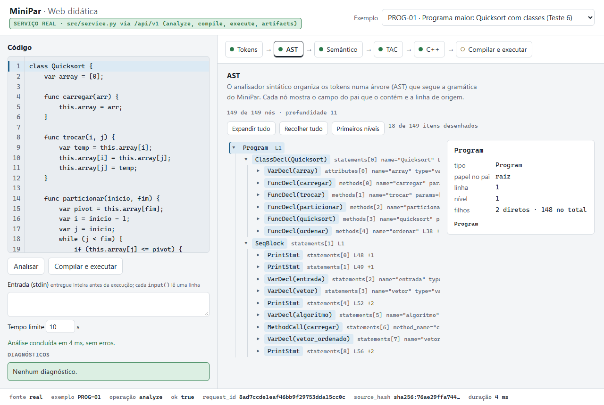

   *Figura 11 — PROG-01 (Quicksort com classes, Teste 6): 149 nós, profundidade 11; só os 18
   itens dos primeiros níveis estão desenhados.*

### 4.5 Tempo limite

9. O tempo limite vai de 1 a 30 s (padrão 10). Um programa que passa do limite é encerrado pelo
   serviço, sem código de saída, e a saída produzida até ali é mostrada.

   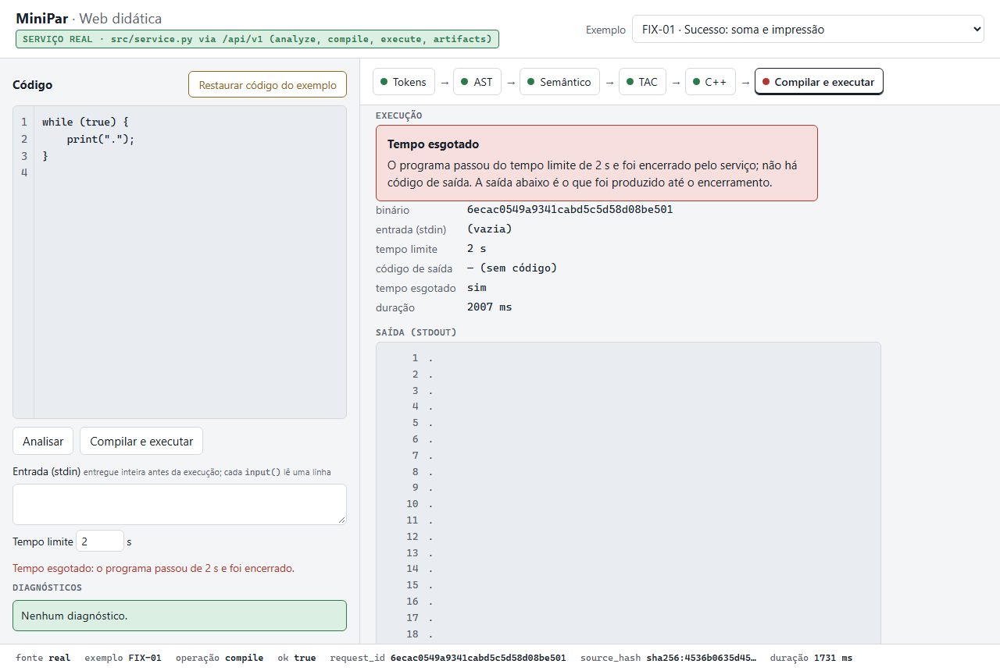

   *Figura 12 — `while (true) { print("."); }` com tempo limite de 2 s: tempo esgotado em
   cerca de 2 s.*

### 4.6 Teste 11 na Web

10. O exemplo **T11** carrega o MiniCompilador escrito em MiniPar e mostra os botões **caso 1**,
    **caso 2** e **caso 3**, que trocam a entrada pelas expressões obrigatórias. Compilar e
    executar com o caso 1 mostra, no stdout, os tokens, a AST, o TAC, o Assembly, a tabela de
    símbolos e o resultado, tudo gerado pelo programa MiniPar.

    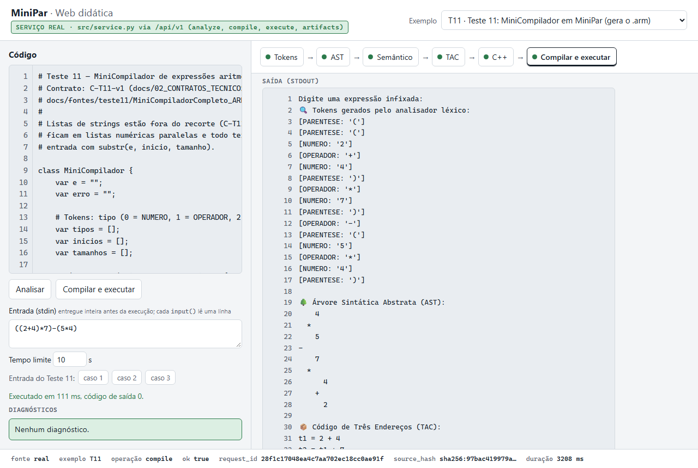

    *Figura 13 — Teste 11, caso 1 `((2+4)*7)-(5*4)`: início do stdout do MiniCompilador.*

11. Escolher **caso 2** e **Executar de novo** roda o mesmo binário com a nova entrada, sem
    recompilar.

    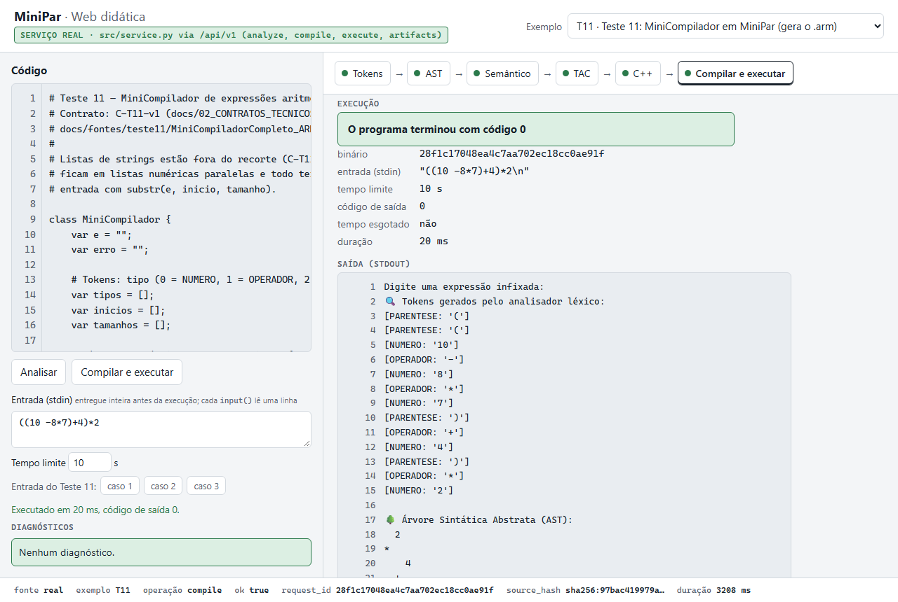

    *Figura 14 — Caso 2 `((10 -8*7)+4)*2` executado de novo no mesmo binário.*

12. **Baixar .arm** recorta do stdout o bloco do Assembly, pelas regras de
    `tests/2026_2/test11/extrair_arm.py`, e grava `t11_<8 do id>.arm`. Esse arquivo é o que se
    abre no CPUlator (seção do Teste 11).

    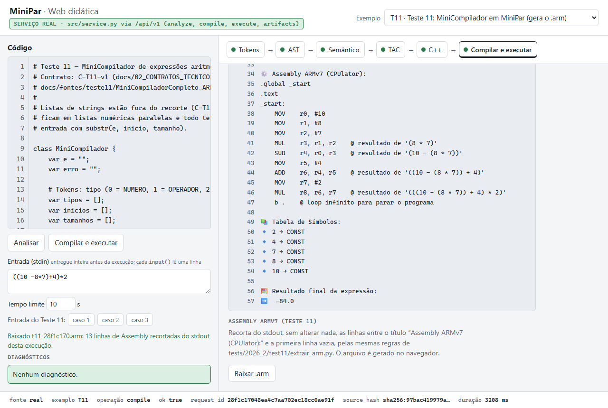

    *Figura 15 — Assembly do caso 2 (resultado em `r8`, −84) e o download do `.arm`.*

13. A página `http://127.0.0.1:5001/static/testes/arm.html` testa o recorte do navegador contra o
    do script, nas seis saídas de teste de C-WEB-v1 §1.10.

    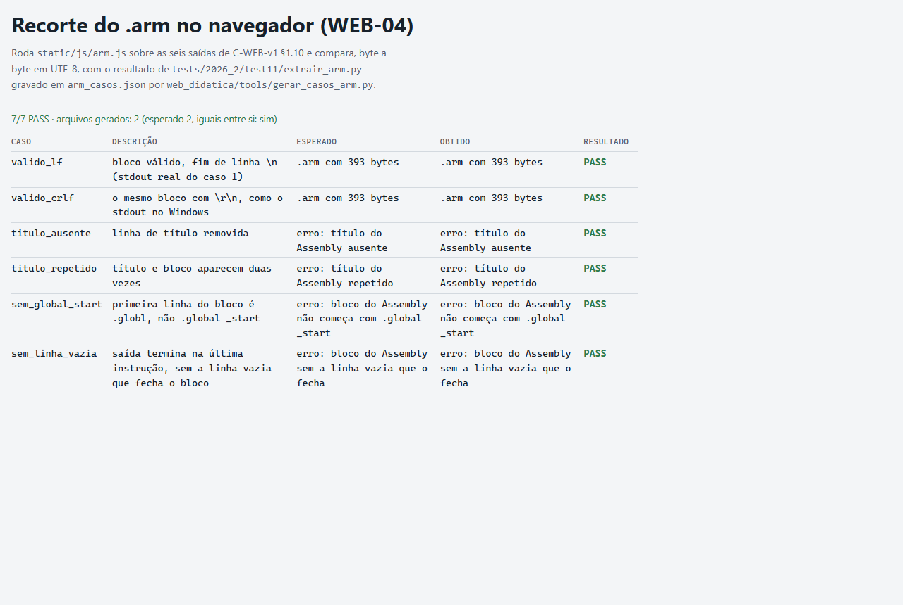

    *Figura 16 — `arm.html`: 7/7 PASS.*

### 4.7 Modo mock

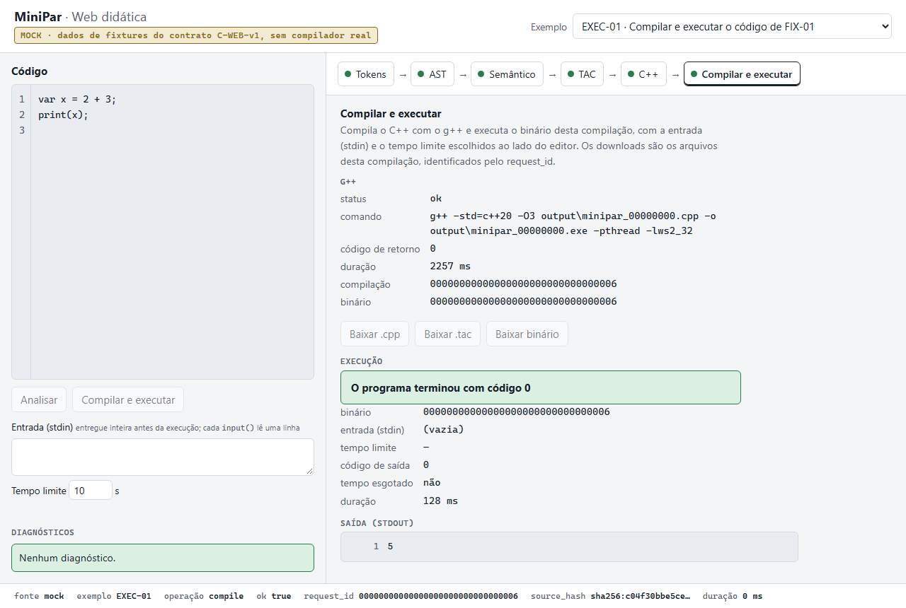

*Figura 17 — `?fonte=mock`: a faixa amarela "MOCK" avisa que os dados são as fixtures do
contrato; Analisar, Compilar e os downloads ficam desabilitados.*

## 5. Validação

| O que foi verificado | Como | Resultado (05/11/2026) |
|---|---|---|
| Rotas, validação de entrada, compilação com g++ real, execução com stdin, código ≠ 0, timeout sem processo vivo, downloads byte a byte, isolamento entre compilações, falhas do g++, três casos do T11 com `.arm` igual ao de referência | `.venv\Scripts\python.exe -B -m unittest discover -s web_didatica/tests -v` | 37 testes, OK |
| Recorte do `.arm` no navegador igual ao do script | `static/testes/arm.html` | 7/7 PASS |
| As 17 telas desta seção, com oráculo conferido antes de cada captura | `web_didatica/tools/capturar_telas.py` | 17/17 PASS |

Oráculos de `capturar_telas.py`, todos de fora da Web: códigos de diagnóstico das fixtures
geradas pelo compilador (`LEX_UNKNOWN_CHAR`, `SYN_EXPECTED_EXPRESSION`,
`SEM_UNDECLARED_VARIABLE`); stdout `5` e código 0 do FIX-01 (ACE-02 do contrato); tempo esgotado
do laço infinito (ACE-07); stdout dos casos 1 e 2 do T11 idêntico a
`tests/2026_2/test11/arm/casoN.stdout.txt`; SHA-256 do `.arm` baixado pelo navegador igual ao de
`tests/2026_2/test11/arm/caso2.arm` (`1a232e2b…6793445e`). O manifesto
`docs/evidencias/WEB-05/manifesto.json` guarda, por figura, o SHA-256 da imagem, o que foi
conferido e os valores lidos da tela.

## 6. Como reproduzir as figuras

```bash
.venv\Scripts\python.exe -B web_didatica/tools/capturar_telas.py
```

O script usa o Chrome ou o Edge instalados, em modo headless, pelo DevTools Protocol (porta só em
127.0.0.1, perfil temporário apagado no fim), e inicia o `server.py` se ele não estiver no ar.
Ele aciona os mesmos botões e campos de uma pessoa, confere o oráculo de cada passo e só então
grava a captura; qualquer divergência encerra com `FAIL` e sem manifesto. Janela de 1280×860,
tema claro. Os ids, durações e caminhos mudam a cada execução; o conteúdo conferido, não.

## 7. Limitações

- O servidor é local (127.0.0.1) e de um usuário; não é um serviço para a rede.
- O serviço mantém os artefatos enquanto o processo roda; `output/web/` cresce até o servidor
  ser reiniciado.
- Diagnósticos com códigos ainda não ratificados no catálogo (proposta
  `docs/CR-CORE08-DIAGNOSTICOS.md`) aparecem com a mensagem do compilador e um texto genérico.
- As figuras foram geradas por um script conduzido pelo agente (Claude Code). Elas mostram a
  interface real, mas, pela seção "Uso de IA" do `AGENTS.md`, um responsável humano deve repetir
  o passo a passo uma vez antes do aceite final.
