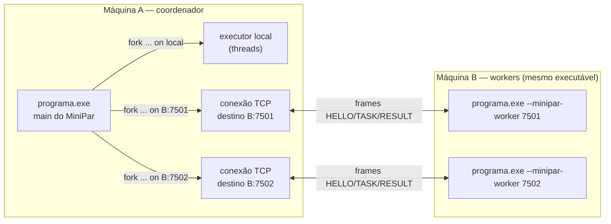

# Runtime de tarefas `minipar_rt` (Eixo C)

Biblioteca C++20 **header-only** que executa as tarefas de Fork/Join do MiniPar 2026.2, no mesmo processo ou em um worker remoto via TCP. `start` dispara uma tarefa e `join` coleta o resultado ou um erro explícito.
Contrato: [`docs/02_CONTRATOS_TECNICOS.md` §2 (C-FJ-v1)](../docs/02_CONTRATOS_TECNICOS.md). Dono: Eixo C. O backend do compilador (`src/`, Eixo A) **consome** esta API no `CORE-07`; o runtime não altera `src/`.

| Card | Escopo | Estado |
|---|---|---|
| `RUN-01` | Runtime local: registry, `start`/`join`, isolamento, erros, `Value` | implementado e testado |
| `RUN-02` | Protocolo TCP enquadrado, worker pré-compilado, falhas | implementado e testado **no loopback** (prova de protocolo) |
| `RUN-03` | Prova em dois computadores reais | programa e roteiro prontos, ensaio no loopback ok; **execução em duas máquinas PASS em 04/11/2026** (log do worker anexado; [roteiro e registro](../docs/evidencias/RUN-03_DOIS_COMPUTADORES.md)) |
| `RUN-04` | Handoff da API para o backend `CORE-07` | contrato dos 13 símbolos testado; interop pela CLI PASS em `dev` (com #17/#18 mergeados), no loopback (seção 6) |
| `RUN-05` | Benchmarks e falhas repetíveis | tempos `seq`/`par` com a mesma carga e falhas F1–F3 PASS nesta máquina ([`tests/2026_2/bench/`](../tests/2026_2/bench/README.md)); cenário em dois PCs pendente |
| `RUN-06` | Protocolo, topologia, deploy e testes | este README (seções 4 a 7) e [`tools/mascarar_log.py`](tools/mascarar_log.py); reprodução por outro integrante pendente ([registro](../docs/evidencias/RUN-06_REPRODUCAO_DOIS_PCS.md)) |

**Por onde começar:** para usar a API, seção 2. Para entender a rede, seções 4 e 5. Para rodar em dois computadores, seção 7.

## 1. Arquivos

```text
runtime/
├── include/minipar_rt/
│   ├── minipar_rt.hpp   # cabeçalho único para incluir
│   ├── value.hpp        # Value, to_value, value_cast (C-FJ-v1 §2.4)
│   ├── core.hpp         # ErrorCode, TaskHandle, TaskResult, Destination, registry, Executor
│   ├── api.hpp          # start, join, join_or_exit (§2.3)
│   ├── json.hpp         # JSON estrito das mensagens (§2.6)
│   ├── net.hpp          # sockets Winsock/POSIX, send_all/recv_exact, frames
│   ├── remote.hpp       # lado coordenador: conexão por destino, HELLO, RESULT por task_id
│   └── worker.hpp       # run_worker, worker_main_if_requested
├── examples/
│   └── demo_distribuida.cpp # RUN-03: coordenador/worker para a prova em dois computadores
├── tools/
│   └── mascarar_log.py      # RUN-06: mascara IPs, hostnames e pastas de usuário nos logs de evidência
└── tests/
    ├── run_tests.py         # compila e executa todos os testes
    ├── test_util.hpp        # mini framework (TEST_CASE/CHECK)
    ├── test_local.cpp       # RUN-01
    ├── join_or_exit_probe.cpp
    ├── test_protocol.cpp    # RUN-02: JSON e frames
    ├── test_worker.cpp      # RUN-02: worker usado nos testes
    ├── test_remote.cpp      # RUN-02: coordenador <-> 2 processos worker
    ├── test_interop.cpp     # RUN-04: API usada pelo C++ gerado (CORE-07), local e remoto
    ├── interop_codegen.py   # RUN-04: MiniPar -> CLI -> C++ gerado -> runtime (exige CORE-07)
    └── fixtures/run04_interop.minipar
```

## 2. Uso

```cpp
#include "minipar_rt/minipar_rt.hpp"
using namespace minipar_rt;

long long soma_quadrados(long long n) { long long s = 0; for (long long i = 0; i < n; ++i) s += i * i; return s; }

int main(int argc, char** argv) {
    set_build_id("<hash do fonte>");                       // o mesmo nas duas máquinas
    register_function("soma_quadrados", [](const TaskArgs& a) {
        return to_value(soma_quadrados(value_cast<long long>(a.at(0))));
    });
    if (int rc = worker_main_if_requested(argc, argv); rc >= 0) return rc;   // modo worker

    TaskHandle h1 = start("soma_quadrados", {1000});                          // local
    TaskHandle h2 = start("soma_quadrados", {2000}, Destination::parse("192.168.0.20:7000"));  // remoto
    TaskResult r = join(h1);                    // r.ok, r.value, r.error.code, r.task_id, r.executed_by
    Value v = join_or_exit(h2, 30000);          // valor, ou mensagem em stderr e exit(1)
}
```

O **mesmo binário** é o worker: `programa --minipar-worker 7000 [--bind <ip>]`. O worker escuta em `127.0.0.1` por padrão; para aceitar conexões de outro computador, passe `--bind` com o IP da máquina na rede local.

Compilação (o mesmo comando vale para o C++ gerado pelo compilador):

```text
g++ -std=c++20 -O2 -pthread -I runtime/include programa.cpp -o programa   [+ -lws2_32 no Windows]
```

**Integração com o C++ gerado (Eixo A):** o cabeçalho inclui `<winsock2.h>`/`<ws2tcpip.h>` no Windows, igual ao prelúdio de `src/cpp_template.py`. Em 22/10/2026, um `.cpp` com o `_CPP_HEADER` atual seguido de `#include "minipar_rt/minipar_rt.hpp"` compilou com `-Wall` e rodou uma tarefa (exit 0). Nenhum arquivo de `src/` foi alterado.

## 3. Comportamento garantido

| ID | Garantia | Teste que cobre |
|---|---|---|
| RT-01 | `start` não espera o cálculo nem a rede (local e remoto): o `TASK` vai para a fila da conexão e uma thread escritora envia | `test_local`: `RT-01 ...`; `test_remote`: `RT-01 remoto ...` e `worker que para de ler ...` (4 `start` de ~7 MiB cada para um worker que não lê retornam em menos de 1 s) |
| RT-02 | Destino inválido não lança no `start`; `join` devolve `BAD_DESTINATION` | `test_local`: `RT-02 ...` |
| RT-03 | Argumentos copiados no `start` | `test_local`: `RT-03 ...` |
| RT-04 | Resultado certo qualquer que seja a ordem de término, inclusive duas tarefas na mesma conexão | `test_local`/`test_remote`: `RT-04 ...` |
| RT-05 | `TIMEOUT` mantém o handle válido | `test_local`/`test_remote`: `RT-05 ...` |
| RT-06 | `join` remoto sem limite usa 60 s (`MINIPAR_RT_REMOTE_TIMEOUT_MS`) | implementação em `core.hpp`/`api.hpp` (não há teste de 60 s) |
| RT-07 | Handle coletado/desconhecido → `INVALID_HANDLE` | `test_local`: `RT-07 ...` |
| RT-08 | Exceção da tarefa → `TASK_FAILED` (local e remoto) | `test_local`: `RT-08`; `test_remote`: `erros remotos ...` |
| RT-09 | Worker morre com tarefas pendentes, ou o envio fica parado mais que `MINIPAR_RT_SEND_TIMEOUT_MS` (padrão 10000 ms) → `WORKER_LOST` sem travar | `test_remote`: `RT-09 worker morre no meio da tarefa` (processo encerrado de fato, exit 3 conferido pelo runner) e `worker que para de ler ...` (o runner usa limite de 1500 ms) |
| RT-10 | `start`/`join` de várias threads | `test_local`: `RT-10 ...` |

Critérios do card `RUN-02` ("fragmentação, frame inválido, worker indisponível e duas tarefas fora de ordem"):

| Critério | Teste |
|---|---|
| Fragmentação | `test_protocol`: `frame: recebido byte a byte`; `test_remote`: `worker aceita HELLO e TASK fragmentados byte a byte`, `coordenador: RESULT fragmentado ...` |
| Mensagens maiores que um `recv` | `test_protocol`: `frame: ... maior que 1 MiB`; `test_remote`: `mensagens maiores que 1 MiB nos dois sentidos` |
| Frame inválido | `test_protocol`: tamanho 0, acima de 8 MiB e fim no meio; `test_remote`: `frame invalido no worker ...` (4 casos: tamanho 0, 2 GiB, JSON quebrado, TASK antes do HELLO; o worker continua atendendo) e servidor falso que manda frame inválido → `PROTOCOL_ERROR` |
| Worker indisponível | `test_remote`: `worker indisponivel ...` e `depois da queda ...` → `WORKER_UNAVAILABLE` |
| Duas tarefas fora de ordem | `test_remote`: `RT-04 remoto: duas tarefas fora de ordem na mesma conexao` |
| IDs / compatibilidade de build | `test_remote`: `160 tarefas em 2 workers ...` (80 por worker, sem perda/duplicação), `build_id diferente vira VERSION_MISMATCH` e `protocol_version` diferente em `TASK` (worker) e em `RESULT` (coordenador) → `VERSION_MISMATCH` |
| Resultado acima de 8 MiB | `test_remote`: `resultado acima de 8 MiB vira TASK_FAILED ...` (resposta imediata, sem esperar o timeout; a conexão continua boa) |

**Execução local:** cada tarefa roda em uma thread de um executor interno que cresce sob demanda. Tarefas simultâneas ganham threads distintas e rodam de fato em paralelo quando há núcleos livres. O runtime **não usa `std::thread::detach`**: com o MinGW-w64/winpthreads do G++ 16.2 UCRT64, uma thread destacada às vezes nunca executava (cerca de 1 em 2000 num teste com 4000 threads), e o `join` ficava esperando para sempre. O teste `estresse: 2000 tarefas...` protege contra essa regressão.

## 4. Topologia

Um programa MiniPar compilado é **um único executável** com dois papéis. Sem argumentos, ele é o **coordenador**: roda o `main` do programa e, a cada `fork ... on <destino>`, chama `start`. Com `--minipar-worker <porta>`, o mesmo arquivo vira **worker**: escuta a porta e só executa as funções registradas nele. Não há servidor central nem código enviado pela rede.



- Um destino (`host:porta`) é **um processo worker** e recebe **uma conexão persistente**, aberta no primeiro `start` para ele. Várias tarefas podem estar pendentes na mesma conexão.
- Um worker roda cada `TASK` numa thread própria. Quatro destinos na mesma máquina são quatro processos que dividem os núcleos dela: **worker não é núcleo** (ver o benchmark do `RUN-05`).
- `local` não usa rede: a tarefa vai para o executor de threads do próprio coordenador.

Sequência de um `fork`/`join` remoto e da queda do worker:

```mermaid
sequenceDiagram
    participant M as main (coordenador)
    participant R as runtime (A)
    participant W as worker (B)
    M->>R: start("avaliar_lote", args, B:7501)
    R-->>M: TaskHandle task-1 (sem esperar a rede)
    R->>W: HELLO {build_id, request_id}
    W-->>R: HELLO_OK {worker_id = host:pid, build_id}
    R->>W: TASK {task_id: task-1, function_id, args}
    Note over W: executa numa thread e registra TASK/RESULT no stderr
    W-->>R: RESULT {task_id: task-1, status: ok, result}
    M->>R: join(task-1)
    R-->>M: valor
    Note over R,W: se a conexão cai com tarefas pendentes, cada join devolve WORKER_LOST;<br/>se o worker não responde, o join devolve TIMEOUT (60 s por padrão)
```

## 5. Protocolo (resumo de C-FJ-v1 §2.6)

O texto normativo é o [contrato C-FJ-v1 §2.6](../docs/02_CONTRATOS_TECNICOS.md): campos de cada mensagem, exemplos JSON e regras de versão. Resumo para operação:

- **TCP com conexão persistente por destino.** Frame = 4 bytes de tamanho big-endian + JSON UTF-8, com 1 a 8 MiB.
- **Mensagens:** `HELLO` (`build_id`) → `HELLO_OK` (`worker_id = host:pid`), depois `TASK` (`task_id`, `function_id`, `args`) → `RESULT` (`status` ok/error). `ERROR` fecha a conexão. `protocol_version` é conferido em toda mensagem, nos dois lados.
- **Handshake:** o coordenador espera o `HELLO_OK` por até 5 s. O `build_id` do programa gerado é o SHA-256 do fonte MiniPar (`src/codegen.py`): coordenador e worker precisam vir **do mesmo fonte**, senão `VERSION_MISMATCH`.
- **Envio:** o coordenador nunca envia na thread do `start`; uma thread escritora por conexão envia os `TASK` na ordem. Coordenador e worker usam `SO_SNDTIMEO` = `MINIPAR_RT_SEND_TIMEOUT_MS` (padrão 10000 ms): um envio sem progresso por esse tempo fecha a conexão (pendentes → `WORKER_LOST`). O limite é por falta de progresso, não pelo tempo total, então mensagens grandes em rede lenta não são cortadas enquanto avançam.
- **Resultado grande:** `RESULT` que passaria de 8 MiB volta como `status` `error` / `TASK_FAILED`.
- **Worker:** registra em stderr `worker_id`, endereço do coordenador, `task_id`, função, resultado e duração de cada tarefa.
- **Segurança:** o worker só executa funções compiladas e registradas no binário; nenhum código chega pela rede. Ele não tem autenticação nem criptografia: é para uso em rede local de laboratório, nunca exposto à internet.

Erros que o `join` pode devolver (no programa gerado, o `join` do coordenador imprime `[minipar_rt] join task-N falhou: <CÓDIGO>: <mensagem>` em stderr e sai com exit 1):

| Código | Quando acontece | Exemplo de causa na prática |
|---|---|---|
| `BAD_DESTINATION` | Destino que não é `local` nem `IPv4:porta` | Erro de digitação no destino lido do `input()` |
| `WORKER_UNAVAILABLE` | Conexão recusada/inalcançável ou handshake sem resposta | Worker não iniciado, porta errada, firewall bloqueando |
| `VERSION_MISMATCH` | `build_id` ou `protocol_version` diferente | Worker compilado de outro fonte ou de outro commit |
| `WORKER_LOST` | A conexão caiu com a tarefa pendente | Worker encerrado (Ctrl+C, kill) ou envio parado por mais de `MINIPAR_RT_SEND_TIMEOUT_MS` |
| `TIMEOUT` | O `join` passou do limite | Worker vivo que não responde; máquina que saiu da rede sem fechar a conexão |
| `TASK_FAILED` | A função lançou exceção, ou o resultado passou de 8 MiB | Divisão por zero dentro da tarefa |
| `UNKNOWN_FUNCTION` | `function_id` não registrado no worker | Não acontece com o mesmo executável; indica binários diferentes |
| `PROTOCOL_ERROR` | Frame ou JSON inválido | Outro serviço escutando a mesma porta |
| `INVALID_HANDLE` | `join` de um handle já coletado ou desconhecido | Erro de programa, não de rede |

Variáveis de ambiente (lidas pelo coordenador e pelo worker; nada é persistido no sistema):

| Variável | Padrão | Efeito |
|---|---|---|
| `MINIPAR_RT_REMOTE_TIMEOUT_MS` | `60000` | Limite do `join` remoto sem timeout explícito (o `join(h)` do MiniPar) |
| `MINIPAR_RT_SEND_TIMEOUT_MS` | `10000` | Tempo máximo de envio sem progresso antes de fechar a conexão |

## 6. Testes

| Nível | Comando (da raiz) | O que prova | Card |
|---|---|---|---|
| Unidade + protocolo + remoto no loopback | `python runtime/tests/run_tests.py` | API local, frames, worker, falhas de rede, interop com o C++ gerado | RUN-01/02/04 |
| MiniPar → C++ gerado → runtime | `python runtime/tests/interop_codegen.py` | O compilador gera chamadas certas ao runtime (local, worker, queda) | RUN-04 |
| Programas de teste | `python tests/2026_2/test08/run_t08.py` (e `test09/run_t09.py`, `test10/run_t10.py`) | T08–T10 com oráculo, nos modos `seq`, `par` local e `par` com workers no loopback | T08/T09/T10 |
| Benchmark e falhas | `python tests/2026_2/bench/run_bench.py [--rapido]` | Tempos com a mesma carga, speedup, e falhas F1–F3 repetidas | RUN-05 |
| Integração dos três eixos | `python scripts/smoke_int01.py` | Compilador + runtime + serviço da Web juntos | INT-01 |
| **Dois computadores** | seção 7 | Execução entre máquinas diferentes | RUN-03/06 |

Todos usam só portas de `127.0.0.1`, exceto a seção 7. Nenhum deles prova execução entre computadores.

```powershell
python runtime/tests/run_tests.py                 # compila com -Wall -Wextra -Werror e executa tudo
python runtime/tests/run_tests.py --cxx g++       # outro compilador
```

O runner sobe dois processos `test_worker` em portas livres de `127.0.0.1` e encerra os dois no final. O worker B **se encerra de propósito** no teste RT-09 (exit 3, conferido pelo runner). Binários e logs (`worker_A.log`, `worker_B.log`) ficam em `output/runtime-tests/` (ignorado pelo Git).

Resultado em 22/10/2026 (Windows 11, G++ 16.2.0 UCRT64): 15 casos locais + probe, 7 de protocolo, 15 remotos e o ensaio do RUN-03, **todos PASS**. A suíte completa rodou 5 vezes seguidas sem falha; a suíte local, 30 vezes.

Resultado em 23/10/2026, depois da correção da revisão do PR #9 (envio assíncrono com limite, `RESULT` acima de 8 MiB, `protocol_version` em toda mensagem): 15 locais + probe, 7 de protocolo, **19 remotos** e o ensaio do RUN-03, todos PASS no Windows 11 (G++ 16.2.0 UCRT64) e no Linux/WSL2 Ubuntu (G++ 15.2.0). Antes da correção, os 4 casos novos falhavam: o `start` ficava preso no envio, o resultado de 9 MiB só terminava no `TIMEOUT` e as mensagens com outra versão eram aceitas.

**O que estes testes NÃO provam:** execução entre dois computadores. Os testes remotos usam processos diferentes no mesmo host (loopback), ou seja, provam o protocolo. A prova em duas máquinas é o card `RUN-03`.

### Prova em dois computadores (`RUN-03`)

`examples/demo_distribuida.cpp` faz os dois papéis com o mesmo binário:

```text
máquina B:  demo_distribuida --minipar-worker 7000 --bind <IP-de-B>
máquina A:  demo_distribuida --coordenador <IP-de-B>:7000
```

O coordenador imprime cinco verificações: outro host, cálculo remoto conferido, executor = worker, comparação local e queda do worker → erro no `join`. Termina com exit 0 só se todas passarem. O roteiro completo, com compilação, a regra de firewall temporária e o registro da evidência, está em [`docs/evidencias/RUN-03_DOIS_COMPUTADORES.md`](../docs/evidencias/RUN-03_DOIS_COMPUTADORES.md).

O `run_tests.py` ensaia esse roteiro no loopback. Lá, a verificação "outro computador" **tem de** dar `FAIL` (mesmo host) e as outras quatro, `PASS`. Esse ensaio não substitui a execução em duas máquinas.

### Handoff para o backend (`RUN-04`)

O C++ gerado pelo `CORE-07` (PR #18, `src/codegen.py` e `src/cpp_template.py`) usa **13 símbolos** do runtime: `Value`, `value_cast`, `to_value`, `TaskHandle`, `TaskArgs`, `Destination::parse`, `start`, `join`, `join_or_exit`, `to_string(ErrorCode)`, `register_function`, `set_build_id` e `worker_main_if_requested`. Esses 13 são a interface entre os eixos: mudar a assinatura ou o comportamento de qualquer um exige CR (contrato C-FJ-v1).

Build esperado do programa gerado: `-std=c++20 -I runtime/include -pthread`, mais `-lws2_32` no Windows.

Dois testes protegem esse contrato:

- **`test_interop.cpp`** (dentro do `run_tests.py`, não depende de `src/`): chama os 13 símbolos do mesmo jeito que o gerador, com uma cópia do `__fj_join` e do formato dos wrappers/`main` do PR #18. São 17 casos: conversões de `Value` (número, string, bool, listas, matrizes), `Destination::parse` com textos vindos do `input()`, `TaskHandle` copiado, `TASK_FAILED`/aridade/`UNKNOWN_FUNCTION`, `join` aninhado, `BAD_DESTINATION`, `VERSION_MISMATCH` com worker de outro `build_id` e o `join_or_exit` do coordenador (exit 1). Se o runtime mudar de um jeito que quebre o backend, este teste falha primeiro.
- **`interop_codegen.py`** (exige o `CORE-07` na árvore): compila `fixtures/run04_interop.minipar` **pela CLI oficial** (`python main.py`) e executa o binário gerado em três cenários: (a) destino `local`; (b) worker no loopback com o mesmo executável, conferindo no log do worker um `TASK`/`RESULT ok` por função e o PID do worker; (c) worker encerrado pelo PID antes do `join`, que tem de terminar com `WORKER_LOST` e exit 1, sem travar. As entradas são sorteadas (semente impressa) e o resultado esperado é calculado em Python. Sem o `CORE-07`, imprime `BLOCKED: backend CORE-07 ausente` e sai com 2.

```powershell
python runtime/tests/run_tests.py                              # inclui test_interop.cpp
python runtime/tests/interop_codegen.py [--port-base 7100]     # só com o CORE-07 na árvore
```

Resultado em 30/10/2026 (Windows 11, G++ 16.2.0 UCRT64): `run_tests.py` com as 6 etapas PASS (17/17 casos do `test_interop.cpp`); `interop_codegen.py` com (a), (b) e (c) PASS, rodado na **integração local** RUN-03 + `dev` + #17 + #18. Em 05/11/2026, com o #17 e o #18 já em `dev`, os dois scripts foram repetidos na branch sincronizada, sem integração local: 6/6 etapas e (a), (b), (c) PASS. Sem o `CORE-07` na árvore, o `interop_codegen.py` dá `BLOCKED`. Nada disso prova execução em dois computadores (RUN-03).

## 7. Deploy em dois computadores

Roteiro para rodar **qualquer programa MiniPar com `fork ... on <IP:porta>`** com o coordenador na máquina A e os workers na máquina B. O exemplo usa o Teste 8 (4 workers); a demo do `RUN-03` segue o mesmo esquema com uma porta só ([roteiro dela](../docs/evidencias/RUN-03_DOIS_COMPUTADORES.md)).

Os comandos são para PowerShell (Windows PowerShell 5.1 ou PowerShell 7) e foram executados entre dois PCs em 09/11/2026 ([`RUN-06`](../docs/evidencias/RUN-06_REPRODUCAO_DOIS_PCS.md)). Logs e saídas ficam na pasta **Downloads** de cada máquina, em `minipar-evidencias\RUN-06\`, para facilitar juntar tudo no fim.

**7.1 Pré-requisitos e preparação da janela (nas duas máquinas)**

- Mesma rede local, de laboratório ou doméstica. Nada de VPN pública nem porta aberta para a internet.
- O **mesmo commit** do repositório (`git rev-parse HEAD` igual nos dois lados). Sem Git (projeto baixado em ZIP), compare o SHA-256 de `tests/2026_2/test08/teste8_avaliadores.minipar`: o `build_id` é o hash do fonte.
- Python 3.10+ e G++ com C++20. No Windows, o MSYS2 UCRT64 (`C:\msys64\ucrt64\bin`).
- O IP de A e o IP de B na rede local (`ipconfig` no Windows, `ip -4 addr` no Linux).

Em **toda janela nova** do PowerShell, rode este bloco. Antes, troque o caminho do repositório e os dois IPs:

```powershell
cd C:\caminho\do\minipar-2026-2             # raiz do repositório (a pasta com main.py e runtime\)
$IP_A = "192.168.0.10"                      # IP de A (coordenador)
$IP_B = "192.168.0.20"                      # IP de B (workers)
$env:PATH = "C:\msys64\ucrt64\bin;$env:PATH"   # G++ só nesta janela
$OutputEncoding = [Console]::InputEncoding = [System.Text.UTF8Encoding]::new($false)
$EVID = Join-Path (New-Object -ComObject Shell.Application).NameSpace('shell:Downloads').Self.Path 'minipar-evidencias\RUN-06'
New-Item -ItemType Directory -Force $EVID | Out-Null
$DEST = 7201..7204 | ForEach-Object { "${IP_B}:$_" }
git rev-parse --short HEAD; $EVID
```

- **Rode da raiz do repositório.** Fora dela, `git` responde `fatal: not a git repository` e os caminhos `output\...` e `runtime\...` não existem.
- **Não pule a linha do `$OutputEncoding`.** No Windows PowerShell 5.1 com o console em UTF-8 (página 65001), o texto passado por `|` ao `.exe` chega com um BOM. O programa lê `\ufeffpar`, não reconhece o modo e roda **sequencial sem erro**: sai `TOTAL 160` e `SOMA_NOTAS` certos sem nenhum worker usado (falso positivo).
- Escreva `"${IP_B}:7201"`, com chaves. Em `"$IP_B:7201"`, o PowerShell lê `$IP_B:` como outra variável e o destino sai vazio.
- As variáveis só valem na janela onde foram criadas. Se fechar a janela, rode o bloco de novo.

No Linux, o equivalente da pasta é `EVID="$(xdg-user-dir DOWNLOAD 2>/dev/null || echo ~/Downloads)/minipar-evidencias/RUN-06"; mkdir -p "$EVID"`, e os comandos abaixo trocam `output\teste8.exe` por `output/teste8.exe`.

**7.2 Compilar nas duas máquinas** (o mesmo fonte gera o mesmo `build_id`):

```powershell
python main.py tests/2026_2/test08/teste8_avaliadores.minipar teste8      # gera output\teste8.exe
(Get-FileHash output\teste8.exe -Algorithm SHA256).Hash.Substring(0,16)   # anotar (Linux: sha256sum)
hostname                                                                  # anotar: o de B entra no 7.7
```

O SHA-256 do `.exe` pode mudar entre máquinas e compilações (o linker grava data e hora); o que precisa ser igual é o `build_id`, que aparece na 1ª linha do log de cada worker.

**7.3 Liberar as portas em B só para A, só durante o teste** (PowerShell **como administrador**, na máquina B, com o IP de A escrito no comando):

```powershell
New-NetFirewallRule -DisplayName "MiniPar workers (temporaria)" -Direction Inbound -Protocol TCP `
  -LocalPort 7201-7204 -RemoteAddress <IP-de-A> -Profile Private -Action Allow
```

No Linux com ufw: `sudo ufw allow from <IP-de-A> to any port 7201:7204 proto tcp`. Se o Windows mostrar o aviso do firewall ao iniciar o worker, marque **só "Redes privadas"**. Depois volte para a janela normal, preparada no 7.1.

**7.4 Subir os workers em B**, os quatro numa janela só, em segundo plano, cada um com seu log:

```powershell
$W = foreach ($p in 7201..7204) {
  Start-Process output\teste8.exe -ArgumentList "--minipar-worker $p --bind $IP_B" `
    -RedirectStandardError "$EVID\worker_${p}_B.log" -WindowStyle Hidden -PassThru }
Start-Sleep 1; $W | Format-Table Id, HasExited                # os 4 com HasExited False
Get-Content "$EVID\worker_720*_B.log"
```

Cada log começa com `[minipar_worker <host-B>:<pid>] escutando em <IP-de-B>:720N (... build_id=...)`. Os workers rodam ocultos: um Ctrl+C na janela não os derruba, e o `$W` guarda os PIDs para o 7.6 e o 7.7. Se a janela for fechada, encerre-os com `Get-Process teste8 | Stop-Process`. Rodar o 7.4 de novo **sobrescreve** os logs: renomeie-os antes, se quiser guardar.

No Linux: `for p in 7201 7202 7203 7204; do output/teste8.exe --minipar-worker $p --bind <IP-de-B> 2> "$EVID/worker_${p}_B.log" & done`.

**7.5 Rodar o coordenador em A:**

```powershell
"seq`n2000000`nlocal`nlocal`nlocal`nlocal" | output\teste8.exe 2>&1 | ForEach-Object { "$_" } | Out-File -Encoding utf8 "$EVID\coordenador_A_seq.txt"
(@("par", "2000000") + $DEST) -join "`n" | output\teste8.exe 2>&1 | ForEach-Object { "$_" } | Out-File -Encoding utf8 "$EVID\coordenador_A.txt"
"exit par = $LASTEXITCODE"                                                 # esperado: 0
Select-String "$EVID\coordenador_A*.txt" -Pattern "^MODO|TOTAL|UNICOS|DUPLICADOS|PERDIDOS|SOMA_NOTAS" | ForEach-Object { "$($_.Filename): $($_.Line)" }
```

O `ForEach-Object { "$_" } | Out-File -Encoding utf8` grava em UTF-8, que é o que o `mascarar_log.py` lê. No Windows PowerShell 5.1, `Tee-Object` e `>` gravariam UTF-16, e a linha de erro viria com o prefixo `NativeCommandError` do PowerShell.

Oráculo: `MODO par` (sem caractere estranho antes de `par`), `TOTAL 160`, `UNICOS 160`, `DUPLICADOS 0`, `PERDIDOS 0` e `SOMA_NOTAS` igual nos dois arquivos. **Em B**, confira que a execução passou pelos workers:

```powershell
Select-String "$EVID\worker_720*_B.log" -Pattern "aceita|RESULT" | ForEach-Object { "$($_.Filename): $($_.Line)" }
```

Cada worker mostra `conexao de <IP-de-A>:<porta> aceita` e um `TASK`/`RESULT ok` de `avaliar_lote`. Sem essas linhas, o `par` não usou a rede, mesmo com o oráculo certo.

Para medir tempos com repetição, rode em A o bench com os mesmos workers (o `bench_t08.exe` vem do mesmo fonte, então o `build_id` é igual). A saída fica em `output\bench\run-<data>\`:

```powershell
python tests/2026_2/bench/run_bench.py --carga 5000000 --reps 7 --reps-falhas 5 --destinos-rede ($DEST -join ",")
```

Detalhes no [bench](../tests/2026_2/bench/README.md#cenário-em-dois-computadores-par_rede).

**7.6 Queda de worker.** Faça só **depois** do 7.5 e do bench terminarem. Primeiro **em B**, na janela do 7.4: o comando abaixo espera o próximo `TASK ... inicio` no log do worker 7201 e encerra esse worker pelo PID. Assim a queda acontece com a tarefa em andamento, sem depender de um Ctrl+C na hora certa.

```powershell
$log = "$EVID\worker_7201_B.log"; $n = (Select-String $log -Pattern "inicio").Count
"vigia armado: pode rodar o coordenador em A"
while ((Select-String $log -Pattern "inicio").Count -eq $n) { Start-Sleep -Milliseconds 200 }
Stop-Process -Id $W[0].Id; "worker 7201 encerrado"
```

Se o vigia for armado com o bench ainda rodando, ele encerra o worker numa rodada do bench. Aí a queda vira `WORKER_UNAVAILABLE` (worker já fora do ar), e não `WORKER_LOST`. Foi o que aconteceu em 09/11.

Depois, **em A**, com uma carga maior na 2ª linha, para a tarefa durar alguns segundos:

```powershell
(@("par", "20000000") + $DEST) -join "`n" | output\teste8.exe 2>&1 | ForEach-Object { "$_" } | Out-File -Encoding utf8 "$EVID\coordenador_A_queda.txt"
"exit queda = $LASTEXITCODE"; Get-Content "$EVID\coordenador_A_queda.txt"   # esperado: 1
```

O coordenador tem de terminar com `[minipar_rt] join task-N falhou: WORKER_LOST: ...` e exit 1, sem travar. Para repetir, suba os workers de novo (7.4).

**7.7 Encerrar e guardar a evidência.** Em **B**:

```powershell
$W | Stop-Process -ErrorAction SilentlyContinue
Get-ChildItem $EVID -File | ForEach-Object {
  python runtime/tools/mascarar_log.py $_.FullName "$EVID\publicar\$($_.Name)" --host "$env:COMPUTERNAME=pc-B" }
```

Remova a regra na janela de administrador: `Remove-NetFirewallRule -DisplayName "MiniPar workers (temporaria)"`.

Em **A**, troque `<hostname-de-B>` pelo que o `hostname` mostrou em B no 7.2. Ele aparece no `worker_id` das mensagens de `WORKER_LOST`.

```powershell
Get-ChildItem $EVID -File | ForEach-Object {
  python runtime/tools/mascarar_log.py $_.FullName "$EVID\publicar\$($_.Name)" --host "$env:COMPUTERNAME=pc-A" --host "<hostname-de-B>=pc-B" }
```

O `mascarar_log.py` troca o 3º octeto dos IPs por `x` (`192.168.x.31`), os hostnames pelos apelidos e as pastas de usuário por `<home>`. Ele imprime `ATENCAO: IPv4 sem mascara` e sai com exit 1 se sobrar um IP sem máscara.

Para juntar a evidência:

1. Leve a pasta `publicar` de B para A (pendrive, e-mail, zip).
2. Copie os arquivos de `publicar` das duas máquinas para `docs/evidencias/RUN-06/`. Os `.log` estão no `.gitignore`: use `git add -f`.
3. Confira os arquivos antes de commitar. **Nunca** commite os originais, fora de `publicar`: eles têm IP completo e hostname.
4. Preencha o registro em [`docs/evidencias/RUN-06_REPRODUCAO_DOIS_PCS.md`](../docs/evidencias/RUN-06_REPRODUCAO_DOIS_PCS.md).

O `bench.json` e o `resumo.md` do bench já saem anonimizados.

**7.8 Problemas comuns**

| Sintoma | Causa provável | O que fazer |
|---|---|---|
| `fatal: not a git repository` ou `output\teste8.exe` não encontrado | Janela fora da raiz do repositório | `cd` para a pasta com `main.py` (7.1) |
| `MODO` com um caractere invisível antes de `par`/`seq`; coordenador termina rápido e os logs de B não mostram `conexao ... aceita` | BOM no stdin (Windows PowerShell 5.1, console em UTF-8): o programa rodou **sequencial** | Rodar a linha do `$OutputEncoding` do 7.1 e repetir |
| Destino vazio (`:7201`) ou `BAD_DESTINATION` | `"$IP_B:7201"` sem chaves, ou `$IP_B` não definido nesta janela | Usar `"${IP_B}:7201"` ou o `$DEST` do 7.1 |
| Arquivo em `publicar` com letras separadas por caracteres nulos | Arquivo gravado em UTF-16 (`Tee-Object` ou `>` no Windows PowerShell 5.1); o `mascarar_log.py` lê UTF-8, então **os IPs não são mascarados** e ele não acusa | Gravar com `ForEach-Object { "$_" } \| Out-File -Encoding utf8`, como no 7.5 |
| `WORKER_UNAVAILABLE ... conexao recusada` | Worker não iniciado, porta errada ou `--bind` em `127.0.0.1` | Conferir a 1ª linha do log de B; usar `--bind <IP-de-B>` |
| `WORKER_UNAVAILABLE ... tempo de conexao esgotado (3000 ms)`, sem `conexao ... aceita` no log de B | Firewall de B descartando os pacotes, ou o worker daquela porta fora do ar (B descarta pacotes para porta fechada em vez de recusar) | Conferir `$W \| Format-Table Id, HasExited` em B; refazer 7.3 com o IP certo de A; perfil de rede "Privada" |
| A queda dá `WORKER_UNAVAILABLE` em vez de `WORKER_LOST` | O vigia do 7.6 encerrou o worker antes (por exemplo, armado durante o bench) | Subir os workers de novo (7.4), armar o vigia e só então rodar a queda em A |
| `VERSION_MISMATCH` | Executáveis de fontes ou commits diferentes | Mesmo commit e recompilar nas duas máquinas (7.2) |
| `nao foi possivel escutar` no worker | Porta já em uso ou IP do `--bind` não é de B | Outra porta, ou conferir o IP com `ipconfig` |
| O `join` demora 60 s e termina em `TIMEOUT` | B saiu da rede sem fechar a conexão | Comportamento esperado; para testes, `MINIPAR_RT_REMOTE_TIMEOUT_MS` menor só no coordenador |
| Duas máquinas com o mesmo hostname | Clonagem de imagem do laboratório | Usar os IPs dos logs para provar que são máquinas diferentes |

## 8. Limitações conhecidas

- Destino só IPv4 (`host:porta`); IPv6 literal não é aceito.
- Uma tarefa que estoura o `timeout` continua executando; não existe cancelamento (o contrato não pede).
- Worker sem autenticação/TLS (ver seção 5).
- Um worker que para de ler só é detectado depois de `MINIPAR_RT_SEND_TIMEOUT_MS` sem progresso no envio; se o worker ainda lê mas nunca responde, quem limita é o timeout do `join` (60 s remoto por padrão).
- Threads ociosas do executor e de conexões ficam vivas até o fim do processo; programas de demonstração encerram com `std::_Exit` depois de imprimir tudo.
